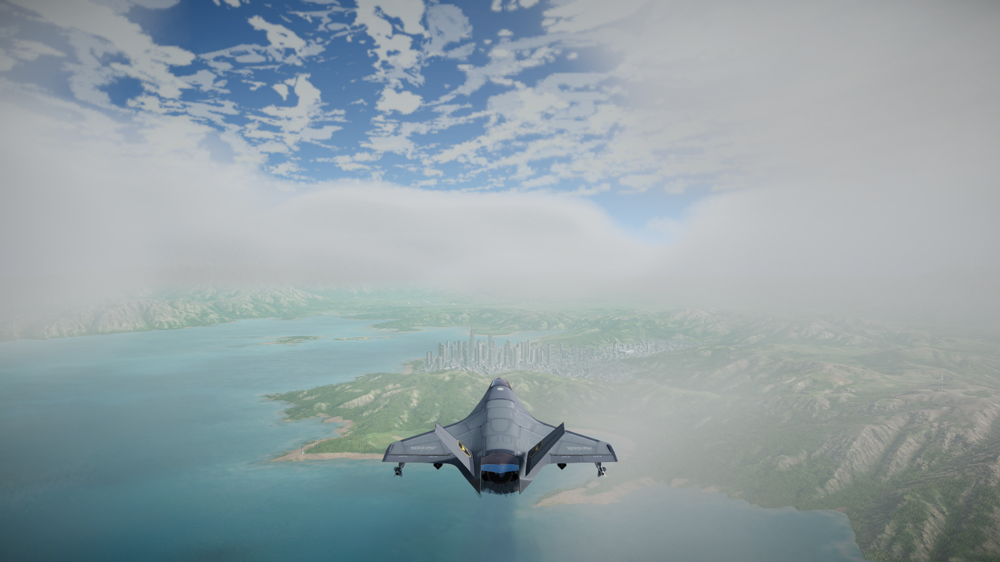

<p align="center">
  
</p>

<p align="center">
  <a href="https://github.com/GrabowMar/Boscali-Summer/releases/tag/v0.2.0-alpha"></a>
  
  <a href="https://github.com/BepInEx/BepInEx/releases"></a>
  <a href="LICENSE"></a>
</p>

<p align="center">
  <b>Fly with a squadron. Call in support. Fight over a front that moves.</b><br>
  A theater overhaul for <i>Nuclear Option</i>, built as a BepInEx plugin.
</p>

<p align="center">
  <a href="#whats-inside">What's inside</a> ·
  <a href="#screenshots">Screenshots</a> ·
  <a href="#install">Install</a> ·
  <a href="#first-flight">First flight</a> ·
  <a href="#troubleshooting">Troubleshooting</a> ·
  <a href="#reporting-a-bug">Report a bug</a> ·
  <a href="#development">Development</a>
</p>

> [!CAUTION]
> **This is an early alpha, and it's rough.** Expect bugs, balance problems, performance dips, broken compatibility and settings that reset between versions. Multiplayer is not reliable yet.
>
> If you'd like to help test, welcome aboard. If you want a stable evening of Nuclear Option, check back in a later release.

## What's inside

Boscali Summer adds layers on top of Nuclear Option's battlefield: wingmen who follow your orders, command consoles on the tactical map, a ground war that leaves fire and ruins behind, and a cockpit with weather, radio and a pilot in it. It is built from independent modules, so what you see depends on the mission, your settings and which optional mods you have installed.

Items marked 🧩 need [Blueprinter](https://github.com/nikkorap/NOBlueprinter-Releases).

<table>
<tr>
<td width="50%" valign="top">

### ✈️ Your wing

- Recruit **wingmen**, pick their loadouts and formations, and give orders from the **WMC** page or the **C** ring.
- Pilots earn **grades and perks** as the squad progresses.
- Meet **enemy ace wings** flying for the other side.

</td>
<td width="50%" valign="top">

### 📡 Support and command

- Call **artillery, cruise missiles, recon, EMP** and experimental kinetic strikes within your allocation.
- Run **SPACE, CYBER and SOF** fronts from the **OPS** page.
- Read the war on the **STR** relief map: territory, frontline, command staff and intel.

</td>
</tr>
<tr>
<td width="50%" valign="top">

### 🔥 A living battlefield

- **Fires and destruction:** burning buildings and wrecks, spreading forest fires, ruins and craters.
- **Fortified towns and trenches** with rooftop MG, AT and AA positions.
- **Airborne insertions:** Ibis fast-rope and rappel drops, plus HALO jumps 🧩.
- **World events and contracts** that shift rewards, prices and morale.

</td>
<td width="50%" valign="top">

### 🛩️ The cockpit

- **TAC BOARD HUD:** stores, countermeasures, cautions and automatic pages for threats, missiles, approach, wing, strikes and refuelling.
- **Weather:** sky profiles, volumetric clouds, in-cloud whiteout, canopy rain and thunder.
- **A pilot in the seat:** first-person body, breathing, cockpit audio and kneeboard cards.
- **Radio** (FM, AIR, MW and your own music) and a **squadron crest** editor.

</td>
</tr>
</table>

<details>
<summary><b>🧩 VANGUARD experimental equipment</b></summary>
<br>

| System | What it is |
| --- | --- |
| **LANCE** / **AEGIS** | Railgun / defence pod |
| **MALD** / **ALE-X** | Decoys / towed decoy |
| **REMORA** / **GLAIVE** | Escort drones / gun drones |
| **HAWC-X** / **ORCA** | Glide weapon / glide torpedo |
| **SKYWELL** | Refuel-and-rearm tender launched from a cargo bay |
| **KESTREL** | Recon glider that orbits a target and lases it |
| **HAMILCAR** | Cargo glider that lands a Hexhound near the target |

Cargo-launched systems also need an aircraft with a compatible cargo bay. All of these are experimental; the [changelog](CHANGELOG.md) describes each one in more detail.

</details>

## Screenshots

<a href="media/readme/command.png"></a>

<table>
<tr>
<td width="50%"><a href="media/readme/cockpit.png"></a></td>
<td width="50%"><a href="media/readme/support.png"></a></td>
</tr>
<tr>
<td align="center"><sub><b>Cockpit</b> · HUD and weather</sub></td>
<td align="center"><sub><b>Support operations</b> · SPACE, CYBER and SOF</sub></td>
</tr>
</table>

<a href="media/readme/vortex-flight.png"></a>

<p align="center"><sub>Top: <b>theater command</b> on the STR page. Bottom: an FS-20 Vortex over the coast in Free Flight.</sub></p>

<details>
<summary>About these captures</summary>
<br>

All four are unedited 1920 × 1080 captures from the running game, taken with **nomodkit** in **Free Flight** on 11 October 2026. Flight, camera and console views were scripted, and development settings and other plugins were left installed. They show what the mod looks like; they are not a performance benchmark or a multiplayer test, and the support allocation shown isn't balanced gameplay. Aircraft and terrain include native Nuclear Option assets.

Records: [scenario](media/readme/scenario.json) · [capture report](media/readme/report.json) · [hashes and build provenance](media/readme/provenance.json)

The banner at the top is generated from the mod's own terrain heightmap by [`tools/Build-ReadmeHeader.py`](tools/Build-ReadmeHeader.py). The aircraft, front line and radar on it are illustration, not a game capture. It stops animating if your system asks for reduced motion.

</details>

## Install

> [!TIP]
> Back up your saves and BepInEx config first. A separate game install for testing is even better.

**You need:**

| | Version | |
| --- | --- | --- |
| **Nuclear Option** | 0.34.2 | Other versions may break the mod. |
| **[BepInEx](https://github.com/BepInEx/BepInEx/releases)** | 5.4.23 or newer 5.x | BepInEx 6 is not supported. |
| **[Blueprinter](https://github.com/nikkorap/NOBlueprinter-Releases)** | optional | Unlocks everything marked 🧩. |
| **[ConfigurationManager](https://github.com/BepInEx/BepInEx.ConfigurationManager)** | optional | Adds the in-game **F1** settings window. |

**Then:**

1. Install BepInEx into the game folder, start the game once so it creates its folders, and close it.
2. Download **`BoscaliSummer-0.2.0.zip`** from the [release page](https://github.com/GrabowMar/Boscali-Summer/releases/tag/v0.2.0-alpha) and extract it into the game folder. You should end up with:

   ```text
   Nuclear Option/BepInEx/plugins/BoscaliSummer/BoscaliSummer.dll
   ```

3. If you used the stand-alone **Wing Command** mod, delete it. It's built in now, and the old plugin is switched off at startup.
4. Start the game.

**Updating?** Close the game, replace the `BoscaliSummer` folder and start again. Always restart fully after an update.<br>
**Using NOMM or NOMNOM?** Pick **BoscaliSummer** and check that it installs the version you meant to test.

## First flight

Start a mission and look for these:

| | |
| --- | --- |
| <kbd>C</kbd> | Interaction ring: wing orders, formations, support and context actions |
| <kbd>F1</kbd> | Settings window, if ConfigurationManager is installed. Turn on **Advanced settings** to see everything. |
| **WMC** | Map page for your wing: pilots, formations, loadouts and orders |
| **STR** | Map page for theater command: territory, frontline and staff |
| **OPS** | Map page for support calls, fronts and readiness |
| **SET** | Map page for module settings, plus host controls for shared rules |

Settings live in `BepInEx/config/com.marci.boscalisummer.cfg`. Modules depend on each other in places, so turning one off can hide features in another.

> [!WARNING]
> **Multiplayer is experimental.** Every player, host included, must run the **same mod version**. The host decides shared rules such as fires, destruction, progression, support prices and events. Even with matching versions, expect rough sessions.

## Troubleshooting

<details>
<summary><b>Nothing from the mod shows up in game</b></summary>
<br>

- Check the path: `BepInEx/plugins/BoscaliSummer/BoscaliSummer.dll`. Some ZIP tools add an extra folder level.
- Make sure you have **BepInEx 5**, not 6, and that you started the game once after installing it.
- Open `BepInEx/LogOutput.log` and search for `BoscaliSummer` to see whether it loaded or why it didn't.

</details>

<details>
<summary><b>VANGUARD gear, cargo gliders or HALO drops are missing</b></summary>
<br>

They need **Blueprinter**. Cargo-launched systems also need an aircraft with a compatible cargo bay, and availability depends on the loadout and which modules are enabled.

</details>

<details>
<summary><b>The log warns about Wing Command</b></summary>
<br>

The old stand-alone Wing Command plugin is still installed. Boscali Summer stops it from running, so nothing is broken, but delete `WingCommand.dll` from `BepInEx/plugins` to clear the warning.

</details>

<details>
<summary><b>Something broke after updating</b></summary>
<br>

Restart the game completely. If that doesn't help, back up and delete `BepInEx/config/com.marci.boscalisummer.cfg` to reset settings, since alpha releases can change them.

</details>

<details>
<summary><b>Multiplayer won't connect or falls out of sync</b></summary>
<br>

Confirm everyone, the host included, has exactly the same mod version. If it still fails, [report it](#reporting-a-bug) with logs from both the host and a client.

</details>

## Reporting a bug

Bug reports are the most useful thing you can send right now: **[open an issue](https://github.com/GrabowMar/Boscali-Summer/issues)**.

A good report has:

- [ ] What happened, what you expected, and steps to reproduce it
- [ ] Game version, mod version and your other mods
- [ ] The mission, and whether you were playing solo, hosting or joining
- [ ] `BepInEx/LogOutput.log`, copied **before** you restart, because the next launch overwrites it. Skim it for personal information first.
- [ ] A screenshot or clip, if it helps

Want more detail in the log? With ConfigurationManager installed, turn on **Advanced settings**, then **Debug → VerboseLogging**.

## Development

You need the **.NET 8 SDK** and a local Nuclear Option install with BepInEx. The build compiles against your game's own assemblies, so point `GameDir` at your game folder:

```powershell
dotnet build BoscaliSummer.sln -c Release -p:GameDir="C:\Program Files (x86)\Steam\steamapps\common\Nuclear Option" -p:PublicRelease=true
```

- `-p:PublicRelease=true` makes a player build with developer cheats and tools locked off; leave it out for a development build.
- The plugin targets `netstandard2.1`. Tests target `net8.0` and run with `dotnet test`, also with `GameDir` set.
- To bump the version, change `<Version>` in `BoscaliSummer.csproj` **and** `PluginVersion` in `Core/Plugin.cs`. The build fails if they differ.
- A green build doesn't mean the game is happy. Test in game, and in multiplayer if you touched anything networked.

<details>
<summary><b>Where things are</b></summary>
<br>

| Path | What's there |
| --- | --- |
| `Core/` | Plugin entry point, module loader and shared services: config, networking, UI, effects and storage |
| `modules/` | One folder per feature module, such as `Wing`, `Support`, `Hud`, `Weather` and `FireAndDestruction` |
| `AvionicsUi/` | The cockpit and console UI toolkit, including its `.avss` display themes |
| `assets/` | Bundled mission and equipment assets |
| `tests/` | Unit tests and in-game test tooling |
| `tools/` | Asset build scripts, capture tooling and the README banner generator |
| `media/readme/` | Images used on this page |

Inside a module, `Domain/` holds game-independent logic (which is what the unit tests cover), alongside `Runtime/`, `Presentation/`, `Networking/`, `Configuration/` and `Patches/` for Harmony patches.

To rebuild the banner after changing the terrain or the design, run `python tools/Build-ReadmeHeader.py`. It needs `numpy`, `contourpy` and `fonttools`, plus the Inter Display and DejaVu Sans Mono fonts.

</details>

## AI usage

> [!NOTE]
> **This mod is developed with help from AI tools.** They help with code, debugging, design exploration, documentation and some visual assets. Some artwork, including the layered pilot portraits, is AI-generated, and the banner and its generator script were made with AI assistance.
>
> **The project author is responsible for everything that ships.** The screenshots on this page are real, unedited game captures.

On this page, "AI wingmen" just means computer-controlled pilots in the game.

## Credits

- **Nuclear Option** by Shockfront Studios
- **[BepInEx](https://github.com/BepInEx/BepInEx)** and **[ConfigurationManager](https://github.com/BepInEx/BepInEx.ConfigurationManager)** by the BepInEx team
- **[Blueprinter](https://github.com/nikkorap/NOBlueprinter-Releases)** by nikkorap
- Banner lettering drawn from **[Inter](https://rsms.me/inter/)** and **[DejaVu Sans Mono](https://dejavu-fonts.github.io/)**

---

<p align="center">
  <sub><b>Boscali Summer</b> by GrabowMar · released under the <a href="LICENSE">MIT license</a></sub><br>
  <sub>An unofficial fan mod. Not affiliated with or endorsed by Shockfront Studios. Nuclear Option and its assets belong to their respective owners.</sub>
</p>
