<p align="center">
  
</p>

<h1 align="center">Boscali Summer</h1>

<p align="center">
  <strong>An experimental theater overhaul for Nuclear Option</strong><br>
  AI wingmen · support operations · a living ground war · cockpit immersion
</p>

<p align="center">
  <strong>0.2.0 ALPHA</strong> &nbsp;·&nbsp; Nuclear Option <strong>0.34.2</strong> &nbsp;·&nbsp; <strong>BepInEx 5</strong><br>
  <a href="https://github.com/GrabowMar/Boscali-Summer/releases/tag/v0.2.0-alpha">Download</a> &nbsp;·&nbsp;
  <a href="CHANGELOG.md">Changelog</a> &nbsp;·&nbsp;
  <a href="https://github.com/GrabowMar/Boscali-Summer/issues">Report a bug</a> &nbsp;·&nbsp;
  <a href="LICENSE">MIT license</a>
</p>

> [!CAUTION]
> **Very early development — not recommended for regular play yet.**
>
> Expect bugs, rough balance, performance problems, broken compatibility and settings resets between versions. Multiplayer is not reliable.
>
> Install it only if you want to help test. For a stable evening of Nuclear Option, wait for a later build.

<p align="center">
  <a href="#overview">Overview</a> &nbsp;/&nbsp;
  <a href="#features">Features</a> &nbsp;/&nbsp;
  <a href="#screenshots">Screenshots</a> &nbsp;/&nbsp;
  <a href="#installation">Installation</a> &nbsp;/&nbsp;
  <a href="#getting-around">Getting around</a> &nbsp;/&nbsp;
  <a href="#troubleshooting">Troubleshooting</a> &nbsp;/&nbsp;
  <a href="#reporting-bugs">Bug reports</a> &nbsp;/&nbsp;
  <a href="#building-from-source">Building</a>
</p>

<p align="center"></p>

## Overview

Boscali Summer turns Nuclear Option's battlefield into a wider theater of war. You fly with a squadron of AI wingmen, call in support from command consoles on the tactical map, and fight over towns, trenches and burning forests while weather, radio and cockpit details make the flight feel more alive.

The mod is split into independent modules. Which systems you see depends on the mission, the modules you have enabled and whether optional dependencies are installed.

**Quick start for testers:** install [BepInEx 5](https://github.com/BepInEx/BepInEx/releases), extract the [0.2.0 alpha ZIP](https://github.com/GrabowMar/Boscali-Summer/releases/tag/v0.2.0-alpha) into the game folder, launch the game, then press **C** in flight. See [Installation](#installation) for the full steps.

<p align="center"></p>

## Features

Features marked 🧩 require **[Blueprinter](https://github.com/nikkorap/NOBlueprinter-Releases)**.

### The battlefield

- **Fire and destruction** — burning buildings and wrecks, spreading forest fires, ruins, scorch marks and blast craters.
- **Fortified towns and trenches** — rooftop MG, anti-tank and anti-aircraft positions, sandbags, faction flags and experimental frontline fortifications.
- **Airborne insertions** — Ibis fast-rope and rappel insertions; HALO drops from supported cargo aircraft 🧩.
- **Theater command and intelligence** — a relief map, territory and frontline views, command staff and intelligence tools.
- **Events and contracts** — battlefield news and optional jobs that affect rewards, funds, prices and morale.

### Your wing and support

- **Wingmen and rival aces** — recruit a squad, choose loadouts and formations, and give orders from the **WMC** page or the **C** menu. Includes grades, perks, squad progression and enemy ace wings.
- **Support and readiness** — call artillery, cruise missiles, recon, EMP and experimental kinetic strikes within your allocation. The **OPS** page tracks SPACE, CYBER and SOF directives, programmes and readiness.
- **VANGUARD equipment** 🧩 — experimental weapons, decoys, and escort or gun drones.
- **Cargo support** 🧩 — SKYWELL refuel/rearm, KESTREL reconnaissance and HAMILCAR cargo gliders. Also needs a compatible cargo bay.

<details>
<summary><strong>VANGUARD equipment reference</strong></summary>

| Equipment | Role |
| --- | --- |
| **LANCE / AEGIS** | Railgun / defence pod |
| **MALD / ALE-X** | Decoys / towed decoy |
| **REMORA / GLAIVE** | Escort drones / gun drones |
| **HAWC-X / ORCA** | Glide weapon / glide torpedo |
| **SKYWELL** | Refuel and rearm tender |
| **KESTREL** | Recon glider |
| **HAMILCAR** | Cargo glider carrying a Hexhound |

All of these are experimental. Availability also depends on the aircraft, loadout and enabled modules. See the [changelog](CHANGELOG.md) for details on each system.

</details>

### Your cockpit

- **TAC BOARD HUD** — stores, countermeasures and cautions, with automatic pages for threats, missiles, approach, wingmen, strikes, refuelling and objectives.
- **Weather** — sky profiles, volumetric clouds, in-cloud whiteout, canopy rain and thunder.
- **Pilot immersion** — a first-person pilot body, control-linked movement, breathing, cockpit audio and kneeboard cards.
- **Cockpit radio** — FM, AIR and MW stations, plus your own music.
- **Squadron identity** — a crest editor, markings on supported tail fins and cosmetic sharing between players.

<p align="center"></p>

## Screenshots

Unedited **1920 × 1080** captures from the running game. Click any image to open it at full size.

<a href="media/readme/command.png"></a>

<p align="center"><sub><strong>Theater command</strong> · Relief map, territory and frontline</sub></p>

<a href="media/readme/cockpit.png"></a>

<p align="center"><sub><strong>The cockpit</strong> · HUD presentation and weather</sub></p>

<table>
  <tr>
    <td width="50%"><a href="media/readme/support.png"></a></td>
    <td width="50%"><a href="media/readme/vortex-flight.png"></a></td>
  </tr>
  <tr>
    <td align="center"><strong>Support operations</strong><br><sub>SPACE, CYBER and SOF readiness</sub></td>
    <td align="center"><strong>Over the coast</strong><br><sub>FS-20 Vortex in Free Flight</sub></td>
  </tr>
</table>

<details>
<summary><strong>How these were captured</strong></summary>

Captured with **nomodkit** in **Free Flight** on **11 October 2026**, in a single-player development session. The player was seated in an FS-20 Vortex; flight, camera and console views were scripted. Existing development settings and other installed plugins were retained.

The images show appearance only. The short capture run was not a performance benchmark, gameplay acceptance test or multiplayer test, and the support allocation shown is not representative of balanced gameplay. Aircraft and terrain include native Nuclear Option assets.

[Capture scenario](media/readme/scenario.json) · [Capture report](media/readme/report.json) · [Image hashes and build provenance](media/readme/provenance.json)

The animated header is an artistic relief chart derived from the mod's terrain height data. Its tactical activity is illustrative, not a gameplay screenshot or live telemetry. The animation respects reduced-motion preferences.

</details>

<p align="center"></p>

## Installation

> [!TIP]
> Use a separate setup if you can, and back up any saves and configuration you care about before installing.

### Requirements

| Requirement | Version | Notes |
| --- | --- | --- |
| **Nuclear Option** | **0.34.2** | Other game versions may break the mod. |
| **[BepInEx 5](https://github.com/BepInEx/BepInEx/releases)** | **5.4.23+** (5.x only) | BepInEx 6 is not supported. |
| **[Blueprinter](https://github.com/nikkorap/NOBlueprinter-Releases)** | optional | Needed for features marked 🧩. |
| **[ConfigurationManager](https://github.com/BepInEx/BepInEx.ConfigurationManager)** | optional | Adds the **F1** settings window. |

### Steps

1. Install **BepInEx 5** into the game folder. Launch the game once and close it, so BepInEx creates its folders.
2. Download **`BoscaliSummer-0.2.0.zip`** from the [0.2.0 alpha release](https://github.com/GrabowMar/Boscali-Summer/releases/tag/v0.2.0-alpha) and extract it into the game folder.
3. Check that the plugin landed here:

   ```text
   Nuclear Option/
   └── BepInEx/
       └── plugins/
           └── BoscaliSummer/
               └── BoscaliSummer.dll
   ```

4. If you have the stand-alone **Wing Command** plugin installed, remove it. Its features are now built in, and the old plugin is disabled at startup.
5. Launch the game.

**Updating:** close the game, replace the `BoscaliSummer` folder with the new version, then start the game again. Always do a full restart after updating.

**Using NOMM / NOMNOM?** Select **BoscaliSummer** and check that the installed version matches the alpha you intended to test.

<p align="center"></p>

## Getting around

### Controls

| Key | Action |
| --- | --- |
| **C** | Interaction ring: flight, wing and context actions |
| **F1** | Settings window (requires ConfigurationManager). Enable **Advanced settings** for more options. |

### Tactical map pages

| Page | What you'll find |
| --- | --- |
| **WMC** — Wing Command | Wingmen, formations, loadouts and orders |
| **STR** — Theater Command | Theater situation, territory and command |
| **OPS** — Support Operations | Support calls, fronts and readiness |
| **SET** — Settings | Module settings; host controls for shared rules |

### Configuration

Settings are stored in `BepInEx/config/com.marci.boscalisummer.cfg`. Some systems depend on others, so disabling one module can make related features unavailable.

### Multiplayer

> [!WARNING]
> **Multiplayer is experimental.** Everyone, including the host, must run the **same mod version**. The host controls shared rules such as fires, destruction, progression, support prices and events. Even with matching versions, sessions may be unreliable.

<p align="center"></p>

## Troubleshooting

<details>
<summary><strong>The mod doesn't seem to load</strong></summary>

- Check that `BoscaliSummer.dll` is at `BepInEx/plugins/BoscaliSummer/BoscaliSummer.dll` (not nested in an extra folder from the ZIP).
- Make sure you are using **BepInEx 5**, not 6, and that you launched the game once after installing it.
- Look in `BepInEx/LogOutput.log` for lines mentioning `BoscaliSummer` or errors at startup.

</details>

<details>
<summary><strong>VANGUARD weapons, cargo gliders or HALO drops are missing</strong></summary>

These need **Blueprinter**. Cargo systems also need an aircraft with a compatible cargo bay. Availability depends on the aircraft, loadout and enabled modules.

</details>

<details>
<summary><strong>A warning about Wing Command appears in the log</strong></summary>

Wing Command is built into Boscali Summer. If the stand-alone **Wing Command** plugin is still installed, Boscali Summer stops it from running and logs a warning. Remove `WingCommand.dll` from `BepInEx/plugins` to clear the warning.

</details>

<details>
<summary><strong>Things broke after updating</strong></summary>

Fully restart the game. If problems persist, back up and then delete `BepInEx/config/com.marci.boscalisummer.cfg` to reset settings; alpha versions can change settings between releases.

</details>

<details>
<summary><strong>Multiplayer desyncs or players can't join</strong></summary>

Confirm that every player, including the host, runs the exact same mod version. If it still fails, please [report it](#reporting-bugs) with logs from both the host and the client.

</details>

<p align="center"></p>

## Reporting bugs

Bug reports are the most useful thing you can contribute right now. [**Open an issue →**](https://github.com/GrabowMar/Boscali-Summer/issues)

Please include:

- **What happened**, what you expected, and the steps to reproduce it.
- **Versions:** game version, mod version, and other installed mods.
- **Context:** the mission, and whether you were in single-player, hosting or joining.
- **The log:** `BepInEx/LogOutput.log` from the game folder. Copy it *before* restarting, because the next launch overwrites it. Check it for personal information before posting.
- A screenshot or clip, if it helps show the problem.

For more detailed logs, install ConfigurationManager, enable **Advanced settings**, then turn on **Debug → VerboseLogging**.

<p align="center"></p>

## Building from source

You need the **.NET 8 SDK or newer** and a local install of Nuclear Option with BepInEx. The build references your installed game's assemblies, so set `GameDir` to your game folder:

```powershell
dotnet build BoscaliSummer.sln -c Release -p:GameDir="C:\Program Files (x86)\Steam\steamapps\common\Nuclear Option" -p:PublicRelease=true
```

- `PublicRelease=true` produces a player build with developer cheats and tools locked off. Omit it for a development build.
- The plugin targets `netstandard2.1`. Tests target `net8.0` and run with `dotnet test`, also with `GameDir` set.
- When bumping the version, update both `<Version>` in `BoscaliSummer.csproj` and `PluginVersion` in `Core/Plugin.cs`. The build fails if they don't match.

A successful build does not guarantee gameplay or multiplayer compatibility. Test in game.

<details>
<summary><strong>Project layout</strong></summary>

| Path | Contents |
| --- | --- |
| `Core/` | Plugin entry point, module loader and shared services (config, networking, UI, FX, storage) |
| `modules/` | One folder per gameplay module, such as `Wing`, `Support`, `Hud`, `Weather` and `FireAndDestruction` |
| `AvionicsUi/` | Shared cockpit and console UI toolkit, including the `.avss` display themes |
| `assets/` | Bundled mission and equipment assets |
| `tests/` | Unit tests and in-game test tooling |
| `tools/` | Asset build scripts and capture tooling |
| `media/readme/` | Images used in this README |

Modules generally follow the same layout: `Domain/` (game-independent logic), `Runtime/`, `Presentation/`, `Networking/`, `Configuration/` and `Patches/` (Harmony patches).

</details>

<p align="center"></p>

## AI usage disclosure

> [!NOTE]
> **AI tools are used to develop this mod.** They help with code, debugging, design exploration, documentation and some visual assets. Some artwork, including the layered pilot portraits and this README's SVG artwork, is AI-generated or AI-assisted.
>
> **The project author is responsible for what ships.** The screenshots above are real, unedited game captures.

In this README, "AI wingmen" means computer-controlled pilots inside the game.

<p align="center"></p>

<p align="center">
  <strong>BOSCALI SUMMER</strong><br>
  <sub>By GrabowMar · Unofficial Nuclear Option fan mod · <a href="LICENSE">MIT license</a></sub><br>
  <sub>Nuclear Option © Shockfront Studios. Not affiliated with or endorsed by Shockfront Studios.<br>Game assets shown belong to their respective creators.</sub>
</p>
