<p align="center">
  
</p>

<p align="center">
  <a href="https://github.com/GrabowMar/Boscali-Summer/releases/tag/v0.2.6-alpha"></a>
  
  <a href="https://github.com/BepInEx/BepInEx/releases"></a>
  <a href="LICENSE"></a>
  <a href="#community"></a>
</p>

<p align="center">
  <b>Fly with a squadron. Call in support. Fight over a front that moves.</b><br>
  A theater overhaul for <i>Nuclear Option</i>.
</p>

<p align="center">
  <a href="#whats-inside">What's inside</a> ·
  <a href="#vanguard">VANGUARD</a> ·
  <a href="#screenshots">Screenshots</a> ·
  <a href="#flight-plan">Flight plan</a> ·
  <a href="#install">Install</a> ·
  <a href="#first-flight">First flight</a> ·
  <a href="#troubleshooting">Troubleshooting</a> ·
  <a href="#community">Community</a>
</p>

<p align="center">
  <a href="#screenshots">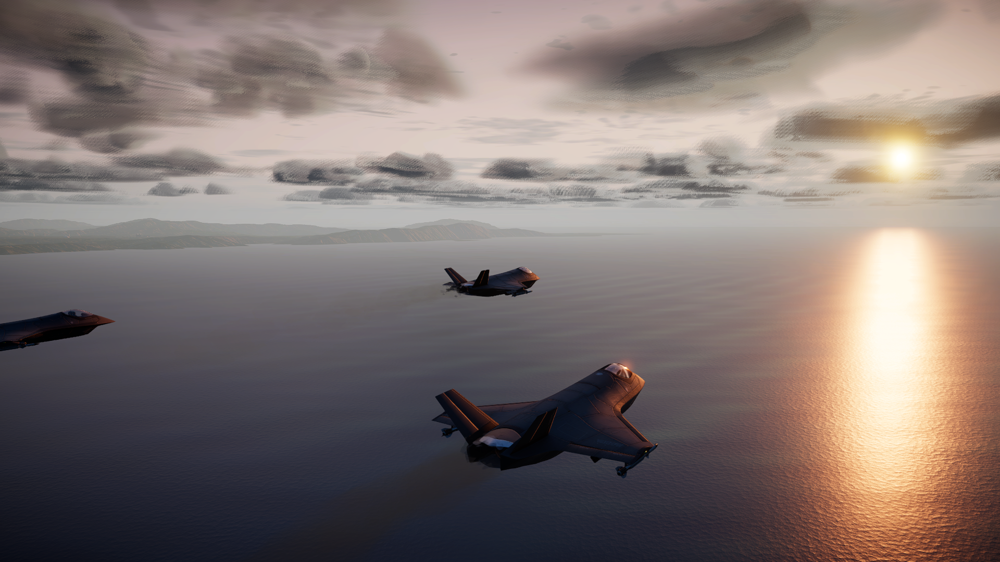</a>
</p>

> *"All flights, Control. Weather is closing from the west, the front moved four klicks overnight and somebody is jamming the tower. Good morning, Boscali."*

Nuclear Option hands you a jet and a war. **Boscali Summer builds everything around the canopy glass**: a wing that flies on your orders, a front line that grinds through towns and leaves them burning, satellites, hackers and special forces on call, storm fronts rolling in off the coast, and a radio full of people having a worse day than you.

Start with **Boscali Summer** in the mission picker's **Boscali Summer** group: a scripted mission on the game's own Escalation. A cutscene, a side to choose, an opening flown under orders, then the whole war. It is one text file, and you can write your own: see [mission scripts](docs/SCENARIOS.md).

Every mission runs the whole mod. When a mission starts, a prompt on the map screen asks which systems run in it: **FULL EXPERIENCE**, **IMMERSION ONLY** (cockpit, HUD, wing, radio and comms; the mission stays as its author made it), or your own pick. It can remember the answer for that mission or stop asking. See [mission systems](docs/MISSION_COMPATIBILITY.md).

<table align="center">
<tr>
<td align="center"><b>30</b><br><sub>modules</sub></td>
<td align="center"><b>47</b><br><sub>skies</sub></td>
<td align="center"><b>11</b><br><sub>VANGUARD systems</sub></td>
<td align="center"><b>9</b><br><sub>automatic HUD pages</sub></td>
<td align="center"><b>3</b><br><sub>support fronts</sub></td>
<td align="center"><b>48</b><br><sub>insignia marks</sub></td>
</tr>
</table>

> [!CAUTION]
> **Early alpha, and it's rough.** Expect bugs, balance problems, performance dips and settings that reset between versions. Multiplayer is not reliable yet. If you'd like to help test, welcome aboard. If you want a stable evening of Nuclear Option, check back in a later release.

## What's inside

Items marked 🧩 need [Blueprinter](https://github.com/nikkorap/NOBlueprinter-Releases).

<table>
<tr>
<td width="50%" valign="top">

### ✈️ Your wing

- **Wingmen who listen.** Recruit them, pick their loadouts and formations, and give orders from the **WMC** page or the **C** ring.
- **Careers.** Pilots earn grades and perks as the squadron progresses.
- **Your colours.** Build a squadron crest from 48 marks and fly it on the tail fins.
- **Enemy aces.** Ace wings hunt for the other side under their own insignia.

</td>
<td width="50%" valign="top">

### 📡 Command and support

- **Fire on call:** artillery, cruise missiles, recon, EMP and experimental kinetic strikes, within your allocation.
- **Three fronts** on the **OPS** page: satellites in SPACE, intrusions in CYBER, teams on the ground in SOF.
- **The war on one map.** The **STR** relief map shows territory, the front line, command staff and intel. The staff proposes operations, you pick, the ground force follows.

</td>
</tr>
<tr>
<td width="50%" valign="top">

### 🔥 A living battlefield

- **Fire and ruin:** burning buildings and wrecks, forest fires that spread, craters that stay.
- **Fortified towns and trenches** with rooftop MG, AT and AA nests. A garrisoned building has to be bombed out.
- **Airborne insertions:** Ibis fast-rope and rappel drops, plus HALO jumps 🧩.
- **World events and contracts** that shift support prices and rewards.

</td>
<td width="50%" valign="top">

### 🎯 The visor

- **TAC BOARD:** helmet-visor symbology for stores, countermeasures and cautions. Choose up to three information pages side by side: threats, shots, missile camera, approach, wing, strikes, refuelling, objectives, systems and cargo. Pages stay where you put them.
- **C ring:** one key, ten categories of live actions. Keyboard, mouse or stick.
- **Holo map and terrain ghost:** a standing hologram in the corner, and a wire relief of the ground showing through the cockpit.
- **Fused night vision:** white phosphor with a thermal glow on hot units.

</td>
</tr>
<tr>
<td width="50%" valign="top">

### ⛈️ The sky

- **47 skies** with volumetric cloud, in-cloud whiteout, rain on the canopy and thunder.
- **Fronts, cells and storms** that drive the day's weather.
- **MET OFFICE:** the host's weather console. Pin a sky, hold the weather, run a set-piece. Clients read along.

</td>
<td width="50%" valign="top">

### 🎧 The seat

- **A pilot in it:** first-person body, breathing, G cues and kneeboard cards.
- **Radio:** FM, AIR, MW and your own music.
- **Radio nets:** AWACS, tower, command and enemy chatter, with voice packs.
- **Chaff** (solo or hosting) that works best when you fly across the missile's line of sight, and not at all head-on.

</td>
</tr>
</table>

## VANGUARD

🧩 The experimental shelf: eleven systems nobody has signed off on.

<p align="center">
  <a href="media/readme/vanguard.png">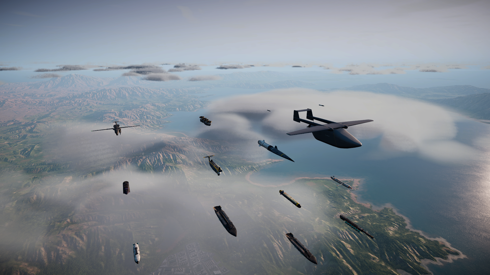</a>
</p>

| System | What it is |
| --- | --- |
| **LANCE** / **AEGIS** | Railgun / defence pod |
| **MALD** / **ALE-X** | Decoys / towed decoy |
| **REMORA** / **GLAIVE** | Escort drones / gun drones |
| **HAWC-X** / **ORCA** | Glide weapon / glide torpedo |
| **SKYWELL** | Refuel-and-rearm tender launched from a cargo bay |
| **KESTREL** | Recon glider that orbits a target and lases it |
| **HAMILCAR** | Cargo glider that lands a Hexhound near the target |

Cargo-launched systems need an aircraft with a compatible cargo bay. The [changelog](CHANGELOG.md) describes each one in detail.

## Screenshots

<table>
<tr>
<td colspan="2"><a href="media/readme/storm.png">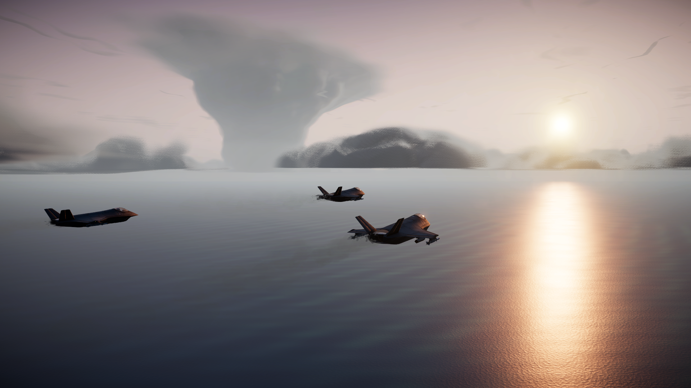</a></td>
</tr>
<tr>
<td colspan="2" align="center"><sub><b>Storm season</b> · the wing under a cumulonimbus at dusk</sub></td>
</tr>
<tr>
<td width="50%"><a href="media/readme/cloud-sea.png">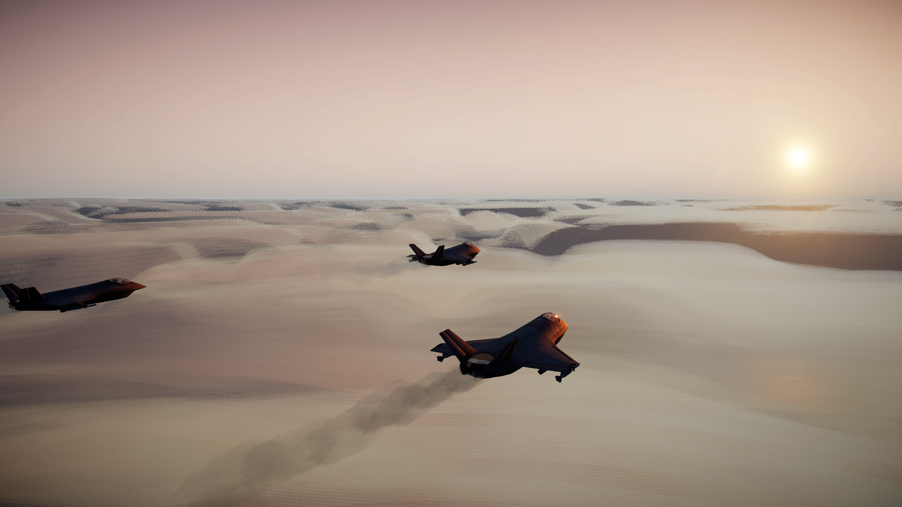</a></td>
<td width="50%"><a href="media/readme/sea-skim.png">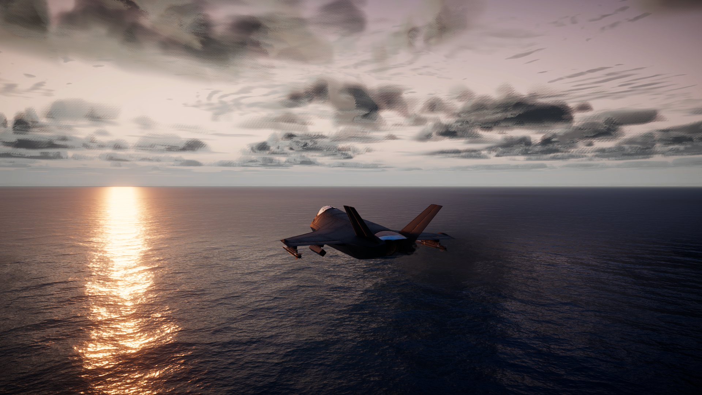</a></td>
</tr>
<tr>
<td align="center"><sub><b>Above the deck</b> · a sea of cloud at sunset</sub></td>
<td align="center"><sub><b>On the deck</b> · 14 m over the water, sun ahead</sub></td>
</tr>
<tr>
<td width="50%"><a href="media/readme/cockpit.png">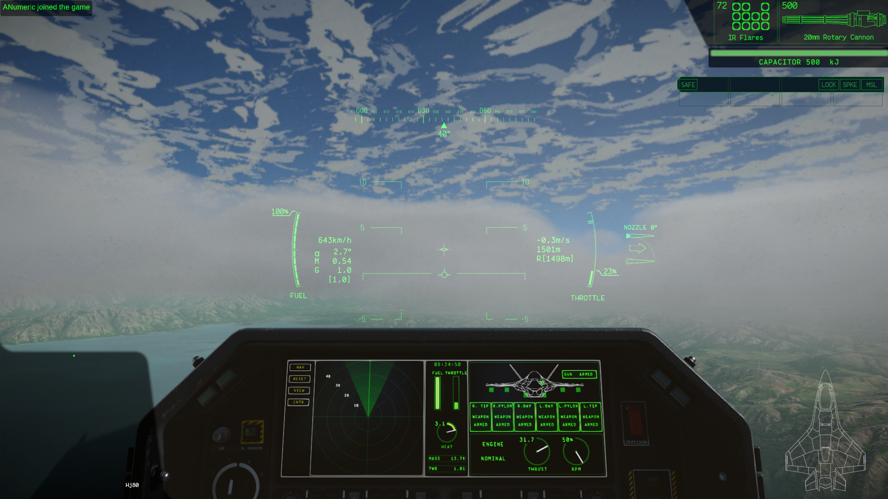</a></td>
<td width="50%"><a href="media/readme/cockpit-storm.png">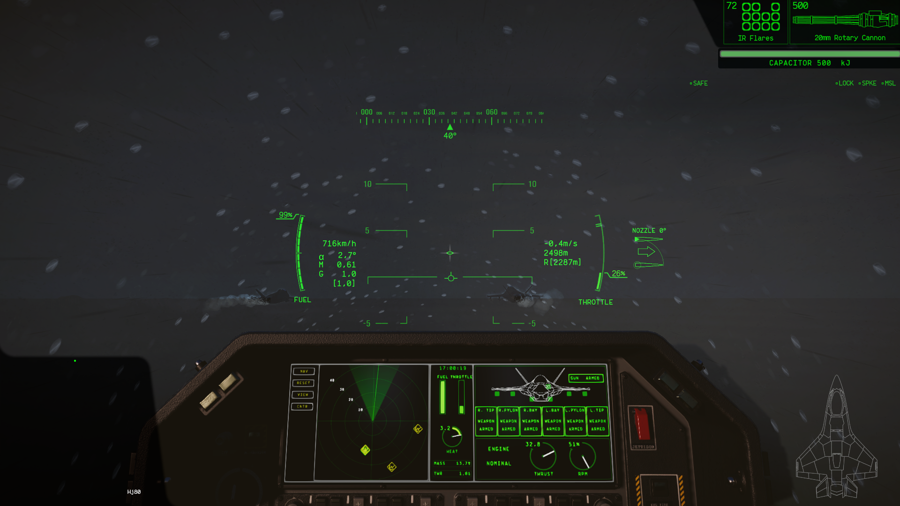</a></td>
</tr>
<tr>
<td align="center"><sub><b>Cockpit</b> · HUD, TAC BOARD and the wing ahead</sub></td>
<td align="center"><sub><b>Weather</b> · rain on the canopy under a storm sky</sub></td>
</tr>
<tr>
<td width="50%"><a href="media/readme/command.png">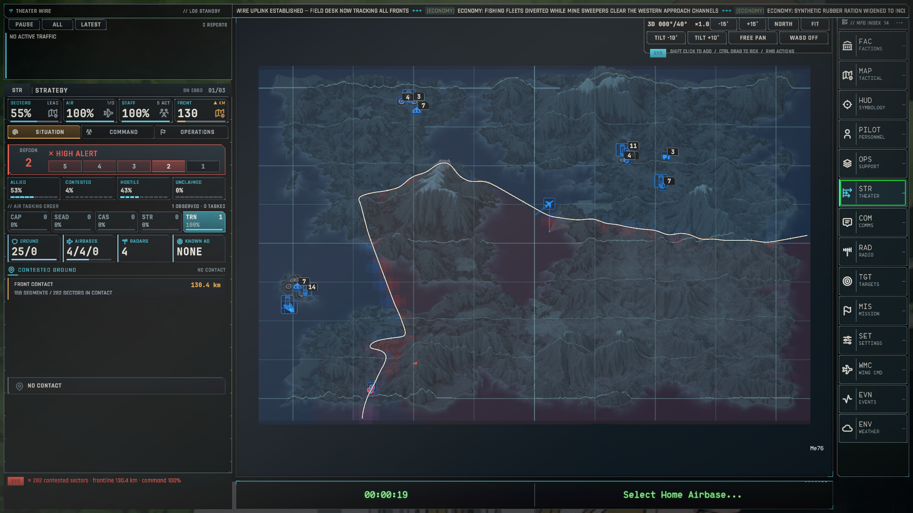</a></td>
<td width="50%"><a href="media/readme/sitrep.png">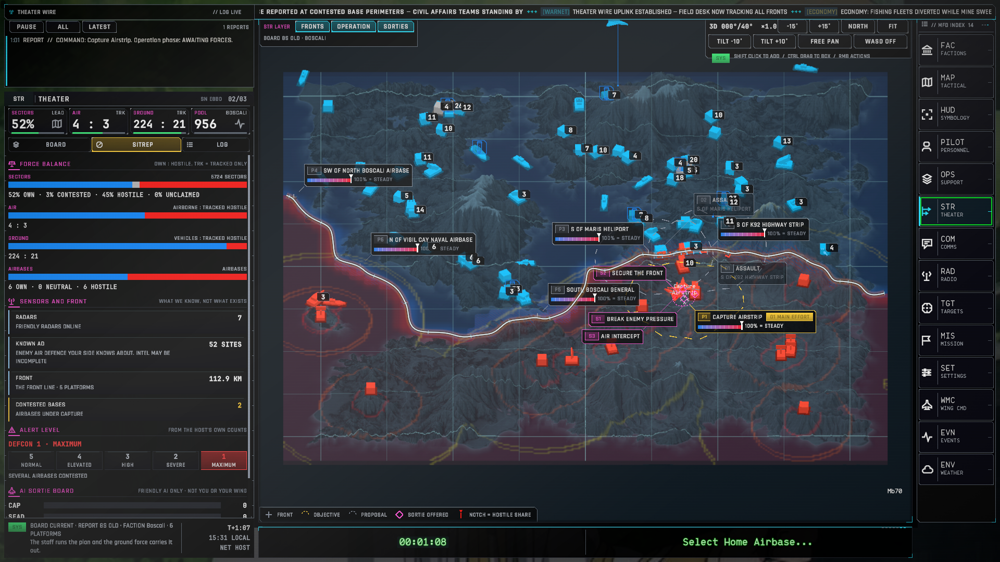</a></td>
</tr>
<tr>
<td align="center"><sub><b>Theater command</b> · the STR board over a live war</sub></td>
<td align="center"><sub><b>Situation report</b> · force balance, sensors and alert level</sub></td>
</tr>
<tr>
<td width="50%"><a href="media/readme/support.png">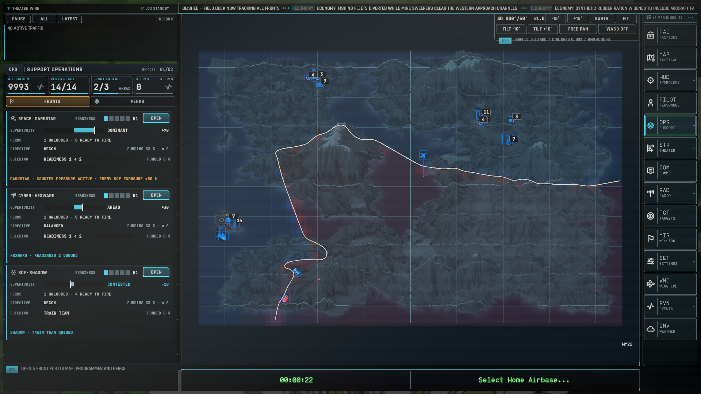</a></td>
<td width="50%"><a href="media/readme/support-space.png">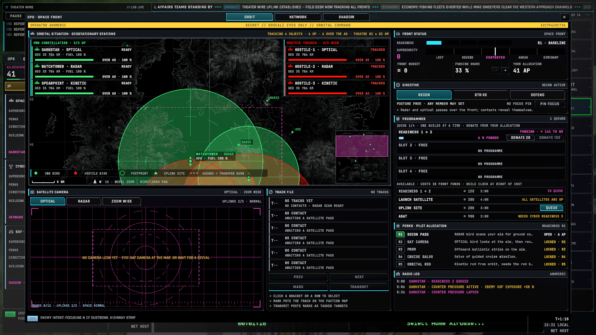</a></td>
</tr>
<tr>
<td align="center"><sub><b>Support operations</b> · SPACE, CYBER and SOF fronts</sub></td>
<td align="center"><sub><b>Space front</b> · satellites, coverage and programmes</sub></td>
</tr>
<tr>
<td width="50%"><a href="media/readme/support-cyber.png">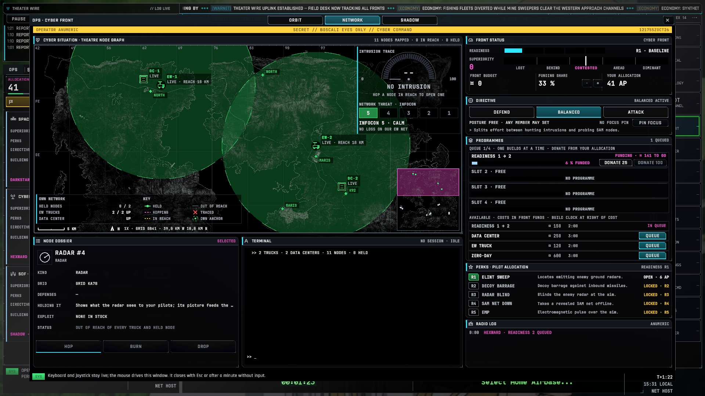</a></td>
<td width="50%"><a href="media/readme/weather-console.png">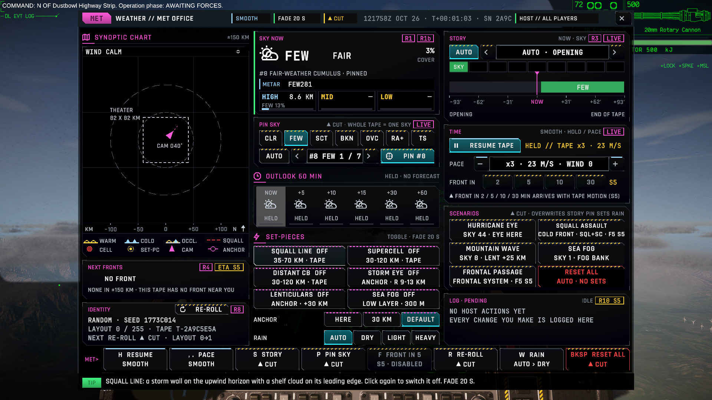</a></td>
</tr>
<tr>
<td align="center"><sub><b>Cyber front</b> · network graph and intrusion trace</sub></td>
<td align="center"><sub><b>MET OFFICE</b> · the host's weather console</sub></td>
</tr>
<tr>
<td colspan="2"><a href="media/readme/low-pass.png">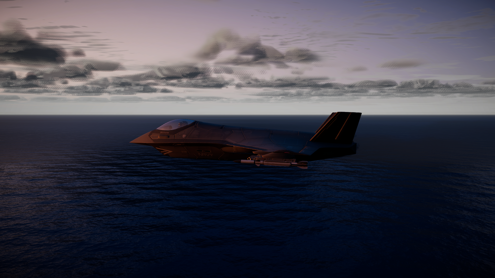</a></td>
</tr>
<tr>
<td colspan="2" align="center"><sub><b>Low pass</b> · an FS-20 over the evening sea</sub></td>
</tr>
</table>

<p align="center"><sub>Unedited in-game captures.</sub></p>

## Flight plan

Where the mod has been, where it is, and where it's pointed.

<p align="center">
  
</p>

<details>
<summary><b>Legs already flown</b></summary>
<br>

The graphic shows major releases only. The updates in between:

| Release | Date | What landed |
| --- | --- | --- |
| **0.2.4** | 14 Oct 2026 | Classic corner map by default, OPS TASKED tab with a steerable cruise missile, community fixes |
| **0.2.3** | 13 Oct 2026 | Map selection feeds the target list, the scripted Boscali Summer mission, mission scripts, C menu stays open |
| **0.2.2** | 13 Oct 2026 | Chaff, rebuilt radio nets, fused night vision, holo map and terrain ghost, regrouped C ring |
| **0.2.1** | 12 Oct 2026 | Visor TAC BOARD, relief map pass, redrawn insignia, display grade |
| **0.2.0** | 10 Oct 2026 | First public alpha: Wing Command built in, TAC BOARD, C ring, VANGUARD, MET OFFICE, airborne insertions, OPS fronts |
| **0.1.3** | 25 Sep 2026 | Trenches, world events, radio, weather, theater operations, ace hunts |
| **0.1.2** | 3 Sep 2026 | Progression, support calls, urban strongholds, EMP strike |
| **0.1.1** | 1 Sep 2026 | First build |

The [changelog](CHANGELOG.md) has the details from 0.2.0 on.

</details>

### Systems check

How far each system is from where it should be at 1.0. Nothing is finished yet: everything in 0.2 is experimental. These are rough estimates, not telemetry.

<p align="center">
  
</p>

### Next legs

No dates. This is a hobby alpha, and the route gets re-planned whenever Nuclear Option updates.

**0.3 · UI + OPS** · *polish what you look at, finish what you command*

- [ ] **HUD quick wins:** IAS/CAS speed mode, cycle targets by type, weapon cycle skips empty stations, a voiced PULL UP
- [ ] **Death debrief card:** what killed you, from how far, and what would have beaten it
- [ ] **Autonomous fronts:** SPACE, CYBER and SOF run themselves while you set the priorities
- [ ] **SOF radar raids** and **CYBER datalink blackouts** that punch a hole in the enemy air defence for a few minutes
- [ ] **STR command map finished:** the wave desk and the strike post
- [ ] **First-flight primer** for the wing, the C ring, OPS and contracts
- [x] **Lock nearest threat**, **chaff** and the **OPS TASKED tab** landed early, in 0.2.x

**0.4 · WEAPONS + MECHANICS** · *answers for the things that keep killing you*

- [ ] **A few more weapons** for VANGUARD
- [ ] **Difficulty presets** for the host (Relaxed, Standard, Vanilla): air-defence interception odds, AA reloads, AI skill, damage taken
- [ ] **SEAD contracts** that pay for radar and SAM kills, with a bonus for clearing a corridor

**0.5 · MECHANICS**

- [ ] **Host rules:** friendly-nuke safe zones, a cap on AI tactical nukes, team-killer handling, catch-up for late joiners
- [ ] **Comeback mechanics:** escalation scaled to the losing side, reinforcement waves for whoever is behind
- [ ] **Wing orders from multiplayer clients**, not only the host

**0.6 · MECHANICS**

- [ ] **Waypoint autopilot** and a single-player time-skip for long transits
- [ ] **AWACS and tanker service** built on SKYWELL
- [ ] **Simple ATC:** landing clearance and vectors to the nearest base
- [ ] **Offline sandbox options:** infinite fuel and ammo, funds and unlocks, single player only

**0.7 · FLYING FORTRESS** · `CLASSIFIED`

**0.8 · MAPS** · *more places to fight over*

- [ ] **Support for more maps** through an external custom maps mod

**0.9 · CAMPAIGN** · *the war remembers*

- [ ] **A war that persists:** fronts, captured bases, faction pools and open contracts carry over between sessions
- [ ] **Campaign chain:** a sequence of sessions and maps with carry-over (the script side exists: chapters that unlock and flags that carry over)
- [ ] **Training contracts:** SEAD, VTOL, carrier landings and the strategic layer

**1.0 · RELEASE** · *last polish*

**Along the way:** compatibility with each new Nuclear Option update comes first, and every feature gets a performance budget measured late in a long match.

Not on the route: VR, missile physics or mid-mission saves. The game's developers and other mods have those covered.

> [!IMPORTANT]
> **WAYPOINT 0.7: FLYING FORTRESS** · `CLASSIFIED`
>
> Something enormous, armed and airborne over Boscali, and every leg before it is a step towards being able to build it. Details when it flies.

## Install

> [!TIP]
> Back up your saves and BepInEx config first. A separate game install for testing is even better.

**You need:**

| | Version | |
| --- | --- | --- |
| **Nuclear Option** | 0.34.2 | Other versions may break the mod. |
| **[BepInEx](https://github.com/BepInEx/BepInEx/releases)** | 5.4.23 or newer 5.x | BepInEx 6 is not supported. |
| **[Blueprinter](https://github.com/nikkorap/NOBlueprinter-Releases)** | optional | Unlocks everything marked 🧩. |
| **[ConfigurationManager](https://github.com/BepInEx/BepInEx.ConfigurationManager)** | optional | Adds the in-game **F1** settings window. |

**Then:**

1. Install BepInEx into the game folder, start the game once so it creates its folders, and close it.
2. Download **`BoscaliSummer-0.2.6.zip`** from the [release page](https://github.com/GrabowMar/Boscali-Summer/releases/tag/v0.2.6-alpha) and extract it into the game folder. You should end up with:

   ```text
   Nuclear Option/BepInEx/plugins/BoscaliSummer/BoscaliSummer.dll
   ```

3. If you used the stand-alone **Wing Command** mod, delete it. It's built in now, and the old plugin is switched off at startup.
4. Start the game.

**Updating?** Close the game, replace the `BoscaliSummer` folder and start again. Always restart fully after an update.<br>
**Using NOMM or NOMNOM?** Pick **BoscaliSummer** and check that it installs the version you meant to test.

## First flight

Start any mission and leave everything on at the mission systems prompt for every system below:

| | |
| --- | --- |
| <kbd>C</kbd> | The ring: weapons, HUD, flight, wing, comms, cockpit, support, view, defence and targets |
| <kbd>Map</kbd> | Tap for the MFD map, hold for the big holo map |
| <kbd>F1</kbd> | Settings window, if ConfigurationManager is installed: on/off switches for the mod's systems, and the keys. Tuning values are in the config file only. |
| <kbd>Ctrl</kbd> + <kbd>O</kbd> | MET OFFICE weather console. The host controls it, clients read along. |
| **WMC** | Map page for your wing: pilots, formations, loadouts and orders |
| **STR** | Theater command, territory, front line and staff |
| **OPS** | Support calls, fronts and readiness |
| **SET** | Map page for module settings, plus host controls for shared rules |

Settings live in `BepInEx/config/com.marci.boscalisummer.cfg`. Modules depend on each other in places, so turning one off can hide features in another.

<details>
<summary><b>TAC BOARD options</b></summary>
<br>

The TAC BOARD is the weapons, systems and warning display at the top of the screen: helmet-visor symbology with no panel behind it, spread wide along the top edge so it covers less of the sides. The classic narrow column is still there as the **STACK** layout. Its options are yours alone, apply at once and can be changed in flight, from whichever of these is handiest:

- **SET → THIS PILOT → COCKPIT:** board on/off, layout, declutter, size, position, opacity, shade, manual page slots and major board parts.
- **C ring → HUD** (key 2, top right of the ring): **Show/Hide TAC BOARD**, **Page 1 / 2 / 3**, **Display options**, **Board parts** and **Reset HUD**. Pick each slot's page manually; **Display options → Page count** chooses one, two or three simultaneous pages.
- **F1:** the **TAC BOARD** switch only.
- **Config file:** the same options under `[TacBoard]` in `com.marci.boscalisummer.cfg`.

What each group does:

- **Board.** **TAC BOARD** off hides the board and gives back the game's own weapon, countermeasure and power panels. **Layout** is wide or stack. **Size** runs from 60 % to 140 %, **move left** and **move down** slide the board away from the top-right corner (in units, a unit being a 1080p pixel), **opacity** fades the ink and **shade** sets the soft dark band behind it (0 % draws none, and a restyled kill feed then has no dark box either).
- **Declutter.** Full shows all enabled detail. Lean drops the gauge row, unlit lamps and captions, and shows supplementary systems status only while something is wrong. Min keeps threat lamps and critical supplementary status. Your manually selected pages stay available at every level.
- **Pages.** One to three full pages sit side by side. Each slot keeps your choice even while its feed is idle; threats, approaches and damage never replace it. Selecting a page already in another visible slot swaps those slots. Alerts continue independently of the selected pages. **RWR hold** controls how long radar-warning contacts remain after their last warning.
- **Board parts.** Six major switches: **Stores + power**, **Tactical pages**, **Aircraft status**, **Notices**, **Nav data** and **Map + feed**. Aircraft status controls its lamps, supplementary systems strip and gauges together. Hiding stores restores the native weapon, countermeasure and power panels.
- **Extras.** **Visor sway** lets the symbols lag a little behind head movement, **restyle feed and map** draws the kill feed and the map frame in the board's look (it stays when the board is off), and **reset to defaults** puts every option back.

</details>

> [!WARNING]
> **Multiplayer is experimental.** Every player, host included, must run the **same mod version**. The host decides shared rules such as fires, destruction, progression, support prices and events. Even with matching versions, expect rough sessions.

## Troubleshooting

<details>
<summary><b>Nothing from the mod shows up in game</b></summary>
<br>

- Check the path: `BepInEx/plugins/BoscaliSummer/BoscaliSummer.dll`. Some ZIP tools add an extra folder level.
- Make sure you have **BepInEx 5**, not 6, and that you started the game once after installing it.
- Open `BepInEx/LogOutput.log` and search for `BoscaliSummer` to see whether it loaded or why it didn't.

</details>

<details>
<summary><b>VANGUARD gear, cargo gliders or HALO drops are missing</b></summary>
<br>

They need **Blueprinter**. Cargo-launched systems also need an aircraft with a compatible cargo bay, and availability depends on the loadout and which modules are enabled.

</details>

<details>
<summary><b>The log warns about Wing Command</b></summary>
<br>

The old stand-alone Wing Command plugin is still installed. Boscali Summer stops it from running, so nothing is broken, but delete `WingCommand.dll` from `BepInEx/plugins` to clear the warning.

</details>

<details>
<summary><b>Something broke after updating</b></summary>
<br>

Restart the game completely. If that doesn't help, back up and delete `BepInEx/config/com.marci.boscalisummer.cfg` to reset settings, since alpha releases can change them.

</details>

<details>
<summary><b>Multiplayer won't connect or falls out of sync</b></summary>
<br>

Confirm everyone, the host included, has exactly the same mod version. If it still fails, [report it](#reporting-a-bug) with logs from both the host and a client.

</details>

## Community

<!-- DISCORD: the server does not exist yet. When it does, replace the line below with the invite link and point the Discord badge at the top of this file at it. -->
**Discord: opening soon.** The server isn't up yet. The invite goes right here the day it is.

Until then, the [issue tracker](https://github.com/GrabowMar/Boscali-Summer/issues) is the briefing room: bugs, ideas and war stories all welcome.

## Reporting a bug

Bug reports are the most useful thing you can send right now: **[open an issue](https://github.com/GrabowMar/Boscali-Summer/issues)**.

A good report has:

- [ ] What happened, what you expected, and steps to reproduce it
- [ ] Game version, mod version and your other mods
- [ ] The mission, and whether you were playing solo, hosting or joining
- [ ] `BepInEx/LogOutput.log`, copied **before** you restart, because the next launch overwrites it. Skim it for personal information first.
- [ ] A screenshot or clip, if it helps

Want more detail in the log? With ConfigurationManager installed, turn on **Advanced settings**, then **Debug → VerboseLogging**.

## Development

You need the **.NET 8 SDK** and a local Nuclear Option install with BepInEx. The build compiles against your game's own assemblies, so point `GameDir` at your game folder:

```powershell
dotnet build BoscaliSummer.sln -c Release -p:GameDir="C:\Program Files (x86)\Steam\steamapps\common\Nuclear Option" -p:PublicRelease=true
```

- `-p:PublicRelease=true` makes a player build with developer cheats, sim hooks and debug tools left out; leave it out for a development build.
- The plugin targets `netstandard2.1`. Tests target `net8.0` and are console runners, not `dotnet test` projects (that command runs nothing): after the build, run `dotnet tests/BoscaliSummer.Tests/bin/Release/net8.0/BoscaliSummer.Tests.dll`.
- To bump the version, change `<Version>` in `BoscaliSummer.csproj` **and** `PluginVersion` in `Core/Plugin.cs`. The build fails if they differ.
- A green build doesn't mean the game is happy. Test in game, and in multiplayer if you touched anything networked.

For Unity asset work through Claude, Codex or OpenCode, nomodkit reads [tools/unity-mcp.json](tools/unity-mcp.json). With `boscalisummer` registered in nomodkit, preview the setup, apply it, then open the editor:

```powershell
nomod unity mcp setup --mod boscalisummer
nomod unity mcp setup --mod boscalisummer --confirm
nomod unity mcp launch --mod boscalisummer --confirm
nomod unity mcp status --mod boscalisummer --json
```

Setup maintains an ignored Unity **2022.3.62f3** workspace at `.nomodkit/unity-mcp`, with MCP for Unity **10.3.0**, URP **14.0.12**, and staged copies of the repository's weather, avionics, pilot, fire, night-vision and emblem asset sources. Locally available Vanguard and airborne models are optional. Only supported asset types are staged; mod/game C# and asset build scripts stay outside the editor project. Keep the editor open while clients use `http://127.0.0.1:8080/mcp`.

Edit staged assets for previews, then deliberately copy desired changes back to their source paths. Rerun setup after source changes to sync the copies; it refuses to overwrite modified staged assets. The existing `tools/Compile-*Assets.ps1` scripts remain the build paths for shipped bundles, and Unity previews do not replace the existing offline or in-game checks.

<details>
<summary><b>Where things are</b></summary>
<br>

| Path | What's there |
| --- | --- |
| `Core/` | Plugin entry point, module loader and shared services: config, networking, UI, effects and storage |
| `modules/` | One folder per feature module, such as `Wing`, `Support`, `Hud`, `Weather` and `FireAndDestruction` |
| `AvionicsUi/` | The cockpit and console UI toolkit, including its `.avss` display themes |
| `assets/` | Bundled mission and equipment assets |
| `tests/` | Unit tests and in-game test tooling |
| `tools/` | Asset build scripts and capture tooling |

Inside a module, `Domain/` holds game-independent logic (which is what the unit tests cover), alongside `Runtime/`, `Presentation/`, `Networking/`, `Configuration/` and `Patches/` for Harmony patches.

</details>

## AI usage

> [!NOTE]
> **This mod is developed with help from AI tools**: code, debugging, design exploration, documentation and some visual assets. Some artwork, including the layered pilot portraits, is AI-generated. The project author is responsible for everything that ships, and the screenshots above are real, unedited game captures.

## Credits

- **Nuclear Option** by Shockfront Studios
- **[BepInEx](https://github.com/BepInEx/BepInEx)** and **[ConfigurationManager](https://github.com/BepInEx/BepInEx.ConfigurationManager)** by the BepInEx team
- **[Blueprinter](https://github.com/nikkorap/NOBlueprinter-Releases)** by nikkorap

---

<p align="center">
  <sub><b>Boscali Summer</b> by GrabowMar · released under the <a href="LICENSE">GNU GPL v3</a> (versions up to 0.2.5 were MIT)</sub><br>
  <sub>An unofficial fan mod. Not affiliated with or endorsed by Shockfront Studios. Nuclear Option and its assets belong to their respective owners.</sub>
</p>
