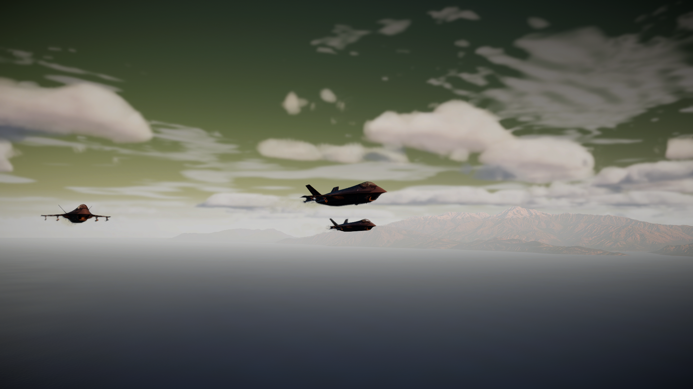
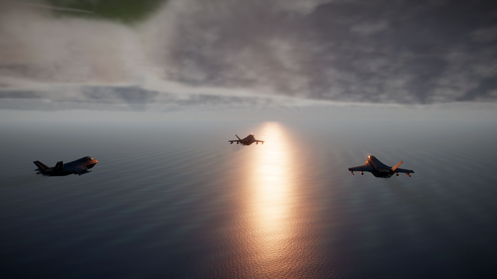
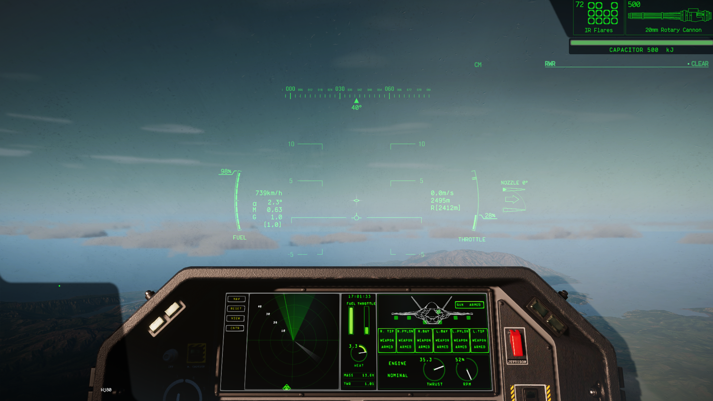
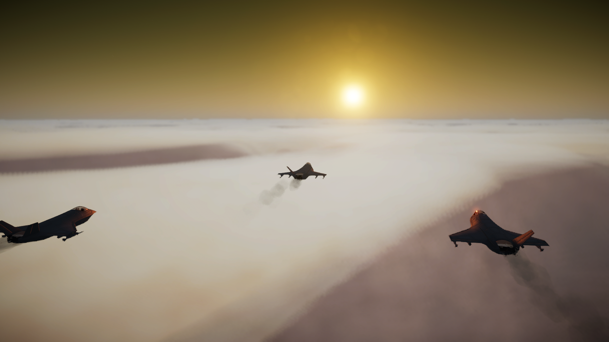
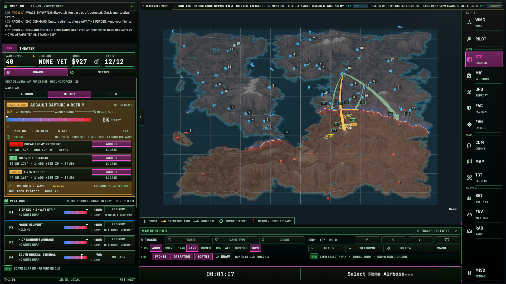
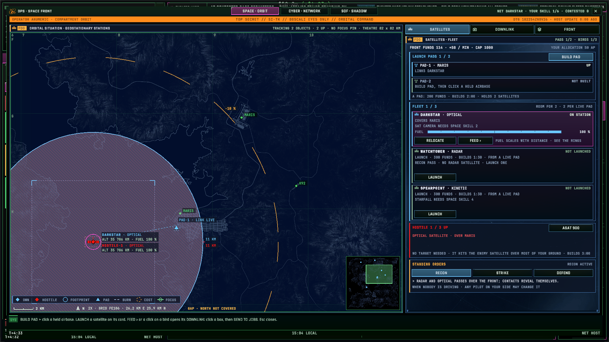
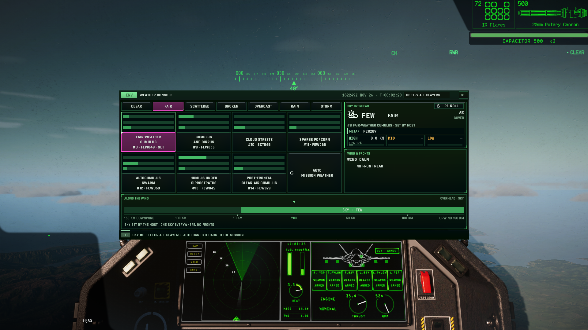
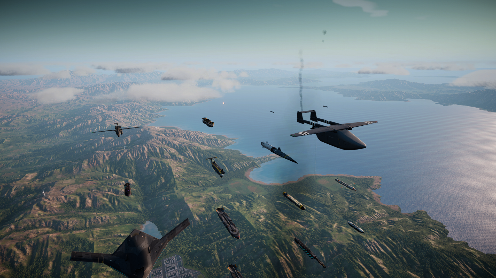

<p align="center">
  
</p>

<p align="center">
  <a href="https://github.com/GrabowMar/Boscali-Summer/releases/tag/v0.2.16-alpha"></a>
  
  
  <a href="https://github.com/BepInEx/BepInEx/releases"></a>
  <a href="LICENSE"></a>
</p>

<p align="center">
  <b>Fly with a squadron. Call in support. Fight over a front that moves.</b><br>
  A theater overhaul for <i>Nuclear Option</i>.
</p>

<p align="center">
  <a href="#whats-inside">What's inside</a> ·
  <a href="#screenshots">Screenshots</a> ·
  <a href="#install">Install</a> ·
  <a href="#first-flight">First flight</a> ·
  <a href="#troubleshooting">Troubleshooting</a> ·
  <a href="#faq">FAQ</a> ·
  <a href="#reporting-a-bug">Report a bug</a> ·
  <a href="#contributing">Contributing</a>
</p>

<p align="center">
  <a href="#screenshots"></a>
</p>

> *"All flights, Control. Weather is closing from the west, the front moved four klicks overnight and somebody is jamming the tower. Good morning, Boscali."*

Nuclear Option hands you a jet and a war. **Boscali Summer builds everything around the canopy glass**: a wing that flies on your orders, a front line that grinds through towns and leaves them burning, satellites, hackers and special forces on call, storm fronts rolling in off the coast, and a radio full of people having a worse day than you.

Start with **The Tassara Job** in the mission picker's **Boscali Summer** group: a small freight-and-aviation firm that is really a mercenary outfit is hired to stop an unmarked cargo flight over the Tassara desert, and the cargo turns out to be guns for a coup. The **Boscali Summer Gamemodes** group adds three more ways to fight:

- **WarBox** — a long combined-arms sandbox with bigger escalation thresholds, reserves and logistics, and a dynamic contract board. Victory is decided by the war's own strategic objectives, not a scoreboard.
- **Fuzzball** — airborne team combat with equal plane access and no ground war. First to 75 kills, or the higher score at 20 minutes.
- **Heavyweight** — cargo delivery against interception. Deliver crates for points, then teams swap roles on the same routes. Highest total wins.

New in **0.2.16** (*Territorial Expansion 2/3*): a new campaign start, **The Tassara Job**, flown for Meridian Freight with Paragon or Renegade radio replies; oil rigs and sea fortresses that break apart point by point; and lived-in scenery on the mod's maps.

Since **0.2.15** (*Territorial Expansion 1/2*, an early and still rough build): the mod's **own maps**. Marisol Islands, Ashkara, Hvitsund and Tassara come with towns, roads, airstrips and game modes of their own.

Since **0.2.14** (the *Helltaker Update*): **Hell's Army**. Summon the invasion from **MISC > SPOOKTOBER** (single-player only), fight its ground and air waves, then dive through the ground rift into Hell and destroy three guarded rift anchors to close it. Hell can capture airbases and spread volcanic corruption; closing the rift restores what it took.

Ordinary missions run the mod too: a prompt on the map screen asks which systems run in them — **FULL EXPERIENCE**, **IMMERSION ONLY** (cockpit, HUD, wing, radio and comms; the mission stays as its author made it) or your own mix, picked system by system on the prompt's list. It can remember the answer per mission, or stop asking.

> [!CAUTION]
> **Alpha software.** Expect bugs, balance problems, performance dips and settings that reset between versions. **Multiplayer is experimental**: every player, host included, needs exactly the same mod version, and sessions can still fall out of sync.
>
> Updates land when they're ready — there's no roadmap or release schedule. Bug reports are welcome and take the place of one; answers may just take a while.

**Known issues**

- Multiplayer can drop out of sync even with matching versions.
- Settings can reset between alpha versions. If something misbehaves after an update, delete `BepInEx/config/com.marci.boscalisummer.cfg` and restart.
- With Blueprinter installed, the log shows `PatchRunner ... Could not set ...` lines at start-up. They are harmless: a few material tweaks in the asset bundle don't apply.
- Performance can dip late in long, busy matches and in heavy weather — see [Low frame rate](#troubleshooting).
- Everything else that's open is on the [issue tracker](https://github.com/GrabowMar/Boscali-Summer/issues).

## What's inside

Items marked 🧩 need [Blueprinter](https://github.com/nikkorap/NOBlueprinter-Releases).

<table>
<tr>
<td width="50%" valign="top">

### ✈️ Your wing

- 🧩 **VS-4 Skylark**, a flyable four-fan VTOL scout and precision attacker.
- **Wingmen who listen.** Recruit them, pick their loadouts and formations, and give orders from the **WMC** wing page or the **C** ring.
- **Careers:** pilots earn grades and perks; build a squadron crest from 48 marks and wear it on the tails.
- **Enemy aces** hunt you under their own insignia.

</td>
<td width="50%" valign="top">

### 📡 Command and support

- **Fire on call:** artillery, cruise missiles, recon, EMP and kinetic strikes, paid from your allocation.
- **Three fronts** on the **OPS** page: satellites in SPACE, intrusions in CYBER, teams on the ground in SOF.
- **The war on one map.** The **STR** relief map shows territory, the front line and command staff; pick an operation and the ground force follows.

</td>
</tr>
<tr>
<td width="50%" valign="top">

### 🔥 A living battlefield

- **Fire and ruin:** burning buildings and wrecks, forest fires that spread, craters that stay.
- **Fortified towns and trenches** with rooftop MG, AT and AA nests. A garrisoned building has to be bombed out.
- **Airborne insertions:** fast-rope and rappel drops, plus HALO jumps 🧩.
- **World events and contracts** shift prices and rewards; sensor reports, track drift, missile faults and decoys each carry a host switch.

</td>
<td width="50%" valign="top">

### 🎯 The visor

- **TAC BOARD:** helmet-visor symbology for stores, countermeasures and cautions, with up to four information pages that stay where you put them.
- **C ring:** one key, ten categories of live actions. Keyboard, mouse or stick.
- **Holo map and terrain ghost:** a standing hologram in the corner, and a wire relief of the ground showing through the cockpit.
- **Fused night vision:** white phosphor with a thermal glow on hot units.

</td>
</tr>
<tr>
<td width="50%" valign="top">

### ⛈️ The sky

- **Layered skies** with volumetric cloud, in-cloud whiteout, rain on the canopy and thunder; fronts and storm cells drive the day's weather.
- **MET OFFICE:** the host's weather console. Pin a sky, hold the weather, run a set-piece. Clients read along.
- **Airfield and city lights** at night — runways with PAPI glide-path guides, lit windows and street lamps. A destroyed building goes dark.
- **Image quality:** optional **CINEMATIC** colour grade (**SET → WORLD → COLOUR GRADE**), **SKY DITHER** against sky banding, and **SMAA** edge smoothing.

</td>
<td width="50%" valign="top">

### 🎧 The seat

- **A pilot in it:** first-person body, breathing, G cues and kneeboard cards.
- **Cockpit alarms and voice warnings:** PULL UP, TERRAIN, OVER G and BINGO FUEL, each switchable.
- **Radio:** FM, AIR, MW and your own music, plus AWACS, tower, command and enemy chatter.
- **Chaff** (solo or hosting) that works best across the missile's line of sight — and not at all head-on.

</td>
</tr>
</table>

Run other visual mods? **SET > COMPAT** shares the sky with **NoAtmoFX** and splits effects with **Kelly's Client Effects**, so nothing gets drawn twice.

### VANGUARD

🧩 The experimental shelf, and nobody has signed off on any of it. Cargo-launched systems need an aircraft with a compatible cargo bay: **LANCE** railgun and **AEGIS** defence pod, **MALD** and **ALE-X** decoys, **REMORA** escort drones and **GLAIVE** gun drones, **HAWC-X** glide weapon and **ORCA** glide torpedo, **SKYWELL** refuel-and-rearm tender, **KESTREL** recon glider and **HAMILCAR** cargo glider.

## Screenshots

<table>
<tr>
<td width="33%"><a href="media/readme/storm.png"></a></td>
<td width="33%"><a href="media/readme/cockpit.png"></a></td>
<td width="33%"><a href="media/readme/cloud-sea.png"></a></td>
</tr>
<tr>
<td align="center"><sub><b>Storm season</b> · the wing under heavy overcast</sub></td>
<td align="center"><sub><b>Cockpit</b> · the HUD over the coast</sub></td>
<td align="center"><sub><b>Above the deck</b> · a sea of cloud at sunset</sub></td>
</tr>
<tr>
<td width="50%"><a href="media/readme/command.png"></a></td>
<td width="50%"><a href="media/readme/support-space.png"></a></td>
</tr>
<tr>
<td align="center"><sub><b>Theater command</b> · the STR board over a live war</sub></td>
<td align="center"><sub><b>Space front</b> · satellites, coverage and programmes</sub></td>
</tr>
<tr>
<td width="50%"><a href="media/readme/weather-console.png"></a></td>
<td width="50%"><a href="media/readme/vanguard.png"></a></td>
</tr>
<tr>
<td align="center"><sub><b>MET OFFICE</b> · the host's weather console</sub></td>
<td align="center"><sub><b>VANGUARD</b> · the experimental shelf over the coast</sub></td>
</tr>
</table>

<p align="center"><sub>Unedited in-game captures.</sub></p>

## Install

> [!TIP]
> Back up your saves and BepInEx config first. A separate game install for testing is even better.

**You need:**

| | Version | |
| --- | --- | --- |
| **Nuclear Option** | 0.34.6 | Other game versions may break the mod. |
| **[BepInEx](https://github.com/BepInEx/BepInEx/releases)** | 5.4.23 or newer 5.x | BepInEx 6 is not supported. |
| **[Blueprinter](https://github.com/nikkorap/NOBlueprinter-Releases)** | optional | Unlocks everything marked 🧩. |
| **[ConfigurationManager](https://github.com/BepInEx/BepInEx.ConfigurationManager)** | optional | Adds the in-game **F1** settings window. |

**Then:**

1. Install BepInEx into the game folder, start the game once so it creates its folders, and close it.
2. Download **`BoscaliSummer-0.2.15.zip`** from the [release page](https://github.com/GrabowMar/Boscali-Summer/releases/tag/v0.2.16-alpha) and extract it into the game folder. You should end up with:

   ```text
   Nuclear Option/BepInEx/plugins/BoscaliSummer/BoscaliSummer.dll
   ```

3. If you used the stand-alone **Wing Command** mod, delete it — it's built in now, and the old plugin is switched off at startup.
4. Start the game.

**Updating?** Close the game, replace the `BoscaliSummer` folder, start again, and restart fully after every update.<br>
**Using NOMM, the community mod manager?** Close the game before you enable, disable or update anything in it: NOMM moves switched-off mods to `BepInEx/disabledPlugins`. Boscali Summer isn't in the NOMM catalogue, so install it by hand as above.<br>
**Uninstalling?** Delete `BepInEx/plugins/BoscaliSummer`. To drop your settings and saved data too, also delete `com.marci.boscalisummer.cfg` and the `BoscaliSummer` folder in `BepInEx/config`.

## First flight

Start any mission and pick **FULL EXPERIENCE** at the mission prompt to have everything below:

| | |
| --- | --- |
| <kbd>C</kbd> | The interaction menu: weapons, HUD, flight, wing, comms, cockpit, support, view, defence and targets. C is only the default — rebind it under **CONTROLS** at the mission prompt or **SET → THIS PILOT → VISUALS → KEYS**. |
| <kbd>Map</kbd> | Tap for the MFD map, hold for the big holo map |
| <kbd>F1</kbd> | Settings window, if ConfigurationManager is installed: on/off switches for every system, and the keys. Tuning values live in the config file only. |
| <kbd>Ctrl</kbd> + <kbd>O</kbd> | MET OFFICE weather console. The host controls it, clients read along. |
| **WMC** | Map page for your wing: pilots, formations, loadouts and orders |
| **STR** | Theater command: territory, front line and staff |
| **OPS** | Support fronts, perks and readiness |
| **SET** | Map page for settings: **THIS PILOT** for your own options, plus host controls for shared rules |
| **MISC** | Map page for the extras, including the **SPOOKTOBER** tab that summons Hell's Army |

Settings live in `BepInEx/config/com.marci.boscalisummer.cfg`. Modules depend on each other, so turning one off can hide features in another. The TAC BOARD's options are yours alone and apply at once, even in flight: **SET → THIS PILOT → HUD**, the **HUD** branch of the C ring, or `[TacBoard]` in the config file.

> [!WARNING]
> **Multiplayer is experimental.** Every player, host included, must run the **same mod version**. The host decides shared rules such as fires, destruction, progression, support prices and events.

## Troubleshooting

Start with `BepInEx/LogOutput.log` — copy it **before** you restart, because the next launch overwrites it. Search it for `Boscali Summer` to see what the mod loaded and what failed.

<details>
<summary><b>Nothing from the mod shows up in game</b></summary>
<br>

- Check the path: `BepInEx/plugins/BoscaliSummer/BoscaliSummer.dll`. Some ZIP tools add an extra folder level.
- Make sure you have **BepInEx 5**, not 6, and that you started the game once after installing it.
- Search the log for `Boscali Summer`. No lines at all means BepInEx never loaded the plugin. A `Module failed` line names the module that didn't start and why.

</details>

<details>
<summary><b>One page or system is missing (WMC, OPS, STR, the TAC BOARD...)</b></summary>
<br>

- **Check the mission prompt.** **IMMERSION ONLY** or a custom mix switches systems off for that mission. To be asked again, set `RememberedMissions = {}` and `AskAtStart = true` under `[Mission]` in the config file, or just switch **AskAtStart** back on in the **F1** window.
- **Check the module switch** in the **F1** window or the config file.
- **Check the log for `Module failed`.** A failed module usually means a game version the mod doesn't know. Updates for new game versions can take a while, so stay on a version from the [Install](#install) table.

</details>

<details>
<summary><b>Low frame rate</b></summary>
<br>

- **SET → THIS PILOT → PERF** has one-click presets and switches for the base game: **LOD CAP**, **SHADOW CAP** and **RENDER SCALE** (50–100 % via `RenderScale` under `[Performance]` in the config file).
- Heavy weather and large fires cost the most. Try a calmer sky, or switch systems off for the mission at the mission prompt.
- If one moment always stutters, report it with what was on screen.

</details>

<details>
<summary><b>My mods vanished after using NOMM</b></summary>
<br>

- **Look in `BepInEx/disabledPlugins`.** NOMM moves mods there when you switch them off, choose **launch vanilla**, or launch into a server from its server browser. Switch them back on in NOMM.
- **If `BepInEx/plugins/BoscaliSummer` holds only empty `Events` and `Music` folders,** delete it and install the mod again — a leftover from versions up to 0.2.10. From 0.2.11 on, the mod keeps nothing of yours inside `plugins`.
- Close the game before you let NOMM change anything.

</details>

<details>
<summary><b>The log is full of warnings</b></summary>
<br>

Most of them are not the mod's. Expected and harmless: Blueprinter `PatchRunner ... Could not set` lines for Boscali Summer materials; four Blueprinter `[Ops] Aircraft Aryx_CargoPlane1 not found` lines at boot when the third-party Aryx MC-260 Chimera pack isn't installed — the optional second carrier for the paratroopers and the Skywell, Hamilcar and Kestrel pods simply isn't added, and everything still mounts on the Tarantula; Blueprinter `Game asset LOD ... has 2 matches` — the game itself ships two materials named `LOD`, and either renders the same; Discord `RPC` and Steam `SDR network config` retries; a Wing Command warning if the old stand-alone plugin is still installed (delete `WingCommand.dll` to clear it).

Anything with `Boscali Summer` in it and the word `Error` or `Exception` is worth a [bug report](#reporting-a-bug).

</details>

<details>
<summary><b>A Skylark lost its gear while parked on a ship</b></summary>
<br>

- `[Skylark] gear ... broke: contact ...` means the gear really did come off, and names the collider the game blamed. The line reads `fold 1,00`, `LockedRetracted` when the gear was stowed: the break follows the airframe part that was torn off, not the wheel's own contact.
- A carrier deck is a moving surface — the ship rides the swell, and its elevator is machinery. Parked with the **gear up**, the airframe rests on it rigidly and a moving deck can shear parts off; park with the **gear down** (AUTO and DRONE modes do this themselves below 10 m) and the suspension rides the motion instead.

</details>

<details>
<summary><b>Multiplayer won't connect or falls out of sync</b></summary>
<br>

Confirm everyone, the host included, has exactly the same mod version. If it still fails, [report it](#reporting-a-bug) with logs from both the host and a client.

</details>

## FAQ

<details>
<summary><b>Will there be updates?</b></summary>
<br>

Yes, when they're ready. There's no roadmap or release schedule, so fixes and support for new game versions arrive now and then. Bug reports are welcome.

</details>

<details>
<summary><b>Do I need Blueprinter?</b></summary>
<br>

No. Blueprinter is optional; it unlocks the features marked 🧩 — the VS-4 Skylark, VANGUARD and HALO jumps.

</details>

<details>
<summary><b>Can I use only part of the mod?</b></summary>
<br>

Yes. Pick **IMMERSION ONLY** or your own mix at the mission prompt, or switch whole modules off in the **F1** window or the config file.

</details>

<details>
<summary><b>Does everyone in multiplayer need it?</b></summary>
<br>

Yes. Every player, host included, needs the same mod version, and the host's settings decide the shared rules.

</details>

<details>
<summary><b>Does it touch my game files?</b></summary>
<br>

No. The mod doesn't modify the game's files: everything it adds lives in `BepInEx/plugins/BoscaliSummer` and in `BepInEx/config` (its `.cfg` file and a `BoscaliSummer` folder for crests, scenarios and other saved data), so deleting those removes it. Back up first anyway, as you would for any alpha mod.

</details>

<details>
<summary><b>Does it work with other mods?</b></summary>
<br>

Usually. **SET > COMPAT** shares the sky with NoAtmoFX and splits effects with Kelly's Client Effects. The stand-alone Wing Command plugin is switched off because Wing Command is built in. With another combat overhaul installed, the overlapping combat adjustments leave the job to it; anything else that clashes is a bug — please report it with both mods' versions.

</details>

<details>
<summary><b>Where do my own music and event pictures go?</b></summary>
<br>

In `BepInEx/config/BoscaliSummer`: radio tracks in `Music` (one folder per station), event pictures in `Events`. Older versions kept them in `BepInEx/plugins/BoscaliSummer`, and the mod moves them over once on its first start.

</details>

<details>
<summary><b>Where are the cheats and game-master tools?</b></summary>
<br>

They exist only in development builds. The release downloads are player builds, with developer cheats and debug tools left out.

</details>

<details>
<summary><b>Can I reuse the code?</b></summary>
<br>

Yes, whole or in parts, under the [MIT licence](LICENSE) — fork the mod, lift one module into your own, or borrow a single patch. Nuclear Option's own assets and code are not part of the offer.

</details>

## Reporting a bug

The [issue tracker](https://github.com/GrabowMar/Boscali-Summer/issues) is open, and a report may take a while to get an answer. A good one has:

- what happened, what you expected, and the steps to reproduce it;
- the game version, the mod version and your other mods;
- the mission, and whether you were playing solo, hosting or joining;
- `BepInEx/LogOutput.log`, copied **before** you restart. Skim it for personal information first;
- a screenshot or clip, if it helps.

Want more detail in the log? With ConfigurationManager installed, turn on **Advanced settings**, then **Debug → VerboseLogging**.

## Contributing

Fixes to existing behaviour are the most likely to be merged, and review can take a while. [CONTRIBUTING.md](CONTRIBUTING.md) covers building the mod, testing a change and the code conventions. Forking it and carrying it on is fine too — the mod's own code is [MIT](LICENSE).

## AI usage

> [!NOTE]
> **This mod is developed with help from AI tools**: code, debugging, design exploration, documentation and some visual assets. The project author is responsible for everything that ships, and the screenshots above are real, unedited game captures.

## Credits and licences

- **Nuclear Option** by Shockfront Studios
- **[BepInEx](https://github.com/BepInEx/BepInEx)** and **[ConfigurationManager](https://github.com/BepInEx/BepInEx.ConfigurationManager)** by the BepInEx team
- **[Blueprinter](https://github.com/nikkorap/NOBlueprinter-Releases)** by nikkorap

Boscali Summer's own code is released under the [MIT licence](LICENSE). Versions 0.2.6 to 0.2.10 were published under the GNU GPL v3. Bundled third-party parts — fonts, icons, shaders, sounds and the Hell's Army creature's model — keep their own licences; the full list with sources is in [THIRD-PARTY-NOTICES.txt](THIRD-PARTY-NOTICES.txt).

---

<p align="center">
  <sub><b>Boscali Summer</b> by GrabowMar · released under the <a href="LICENSE">MIT licence</a></sub><br>
  <sub>This project is an unofficial community modification and is not affiliated with, sponsored by, or endorsed by Shockfront Studios Pty Ltd. Original Nuclear Option assets, vehicle designs, audio, and code are Copyright (c) 2026 Shockfront Studios Pty Ltd. All rights reserved. Nuclear Option and Shockfront Studios are trademarks or registered trademarks of Shockfront Studios Pty Ltd. Original mod content and all other trademarks belong to their respective owners.</sub>
</p>
