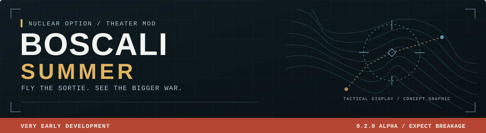
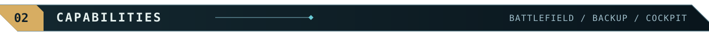

<p align="center">
  
</p>

<p align="center">
  <strong>An experimental theater overhaul for Nuclear Option.</strong><br>
  Living battlefields. Wingmen. Support operations. Cockpit immersion.
</p>

<p align="center">
  <a href="#features"><strong>Features</strong></a> &nbsp; / &nbsp;
  <a href="#screenshots"><strong>Screenshots</strong></a> &nbsp; / &nbsp;
  <a href="#ai-usage-disclosure"><strong>AI disclosure</strong></a> &nbsp; / &nbsp;
  <a href="#testing-the-alpha"><strong>Test the alpha</strong></a> &nbsp; / &nbsp;
  <a href="https://github.com/GrabowMar/Boscali-Summer/issues"><strong>Report a bug</strong></a>
</p>

# VERY EARLY DEVELOPMENT

## I do not recommend playing this right now.

> [!CAUTION]
> **Want a stable evening of Nuclear Option? Wait for a more mature build.**
>
> This is an unfinished experiment. Expect bugs, rough balance, performance problems, broken compatibility and settings resets between versions. Features listed here are under development; they are not promises of polish or multiplayer reliability.
>
> **Install only if you actively want to help test it.**

<p align="center">
  <strong>0.2.0 ALPHA</strong> &nbsp; · &nbsp; GAME TARGET <strong>0.34.2</strong> &nbsp; · &nbsp; <strong>BEPINEX 5</strong><br>
  <a href="https://github.com/GrabowMar/Boscali-Summer/releases">Development releases</a> &nbsp; · &nbsp;
  <a href="CHANGELOG.md">What's changed</a> &nbsp; · &nbsp;
  <a href="LICENSE">MIT license</a>
</p>

<p align="center"></p>

### Fly the sortie. See the bigger war.

Forests burn below you. Towns dig in. Your wing needs orders, the support desk has options, and the weather can close the window. Boscali Summer brings these experiments together around Nuclear Option's air combat.

<a href="media/readme/vortex-flight.png"></a>

<p align="center"><sub>FS-20 Vortex over the coast · Actual in-game capture · Scripted single-player development session</sub></p>

<p align="center"></p>

## Features

**Every system below is experimental.** Availability depends on enabled modules, the mission and optional dependencies.

### The battlefield

**The ground war has a presence from the air.**

- **Fire & destruction** — burning buildings and wrecks, spreading forest fires, ruins, scorch marks and blast craters.
- **Fortified towns & trenches** — rooftop MG, anti-tank and anti-aircraft positions, sandbags, faction flags and experimental frontline fortifications.
- **Airborne operations** — HALO drops, Ibis fast-rope and rappel insertions, plus supported cargo-aircraft paradrops. Some content requires Blueprinter.
- **Command & intelligence** — frontline views, command staff, intelligence tools and expanded tactical-map consoles.
- **Events & contracts** — battlefield news and optional jobs that can affect rewards, funds, prices and morale.

### Your backup

**Take a wing. Call support. Manage the resources behind the sortie.**

- **AI wingmen** — recruit a squad, choose loadouts, fly formations and issue orders through **WMC** and the **C** menu. The former stand-alone Wing Command mod is built in.
- **Progression & rival aces** — grades, perks, squad management and enemy ace wings.
- **Support calls** — artillery, cruise missiles, recon, EMP and experimental kinetic strikes, constrained by your allocation.
- **SPACE / CYBER / SOF** — directives, programmes and readiness across three experimental support fronts.
- **VANGUARD equipment** — experimental weapons, decoys and drones. **Requires Blueprinter.**
- **Cargo-bay support** — deployable refuel/rearm, reconnaissance and cargo gliders. Compatible aircraft and dependencies required.

<details>
<summary><strong>Open the VANGUARD equipment list</strong></summary>

| Equipment | Role |
| --- | --- |
| **LANCE / AEGIS** | Railgun / defence pod |
| **MALD / ALE-X** | Decoys / towed decoy |
| **REMORA / GLAIVE** | Escort drones / gun drones |
| **HAWC-X / ORCA** | Glide weapon / glide torpedo |
| **SKYWELL** | Refuel and rearm tender |
| **KESTREL** | Recon glider |
| **HAMILCAR** | Cargo glider carrying a Hexhound |

</details>

### The cockpit

**More information, atmosphere and squadron identity.**

- **TAC BOARD HUD** — stores, countermeasures, cautions and contextual pages for threats, missiles, approach, wingmen, strikes, refuelling and objectives.
- **Weather** — sky profiles, volumetric clouds, in-cloud whiteout, canopy rain and thunder.
- **Pilot immersion** — first-person pilot body, control-linked movement, breathing, cockpit audio and kneeboard cards.
- **Cockpit radio** — FM, AIR and MW stations, plus your own music.
- **Squadron insignia** — crest editing, markings on supported tail fins and cosmetic sharing between players.
- **Comms & settings** — in-game information and configuration consoles alongside the tactical map.

<p align="center"></p>

## Screenshots

**From the running game.** Captured with nomodkit at **1920 × 1080**. Flight, camera and console views were staged in single-player; these images show appearance, not stability or multiplayer readiness. Click any image for the full-size capture.

<a href="media/readme/cockpit.png"></a>

<p align="center"><sub>COCKPIT / HUD &amp; atmosphere</sub></p>

<table>
  <tr>
    <td width="50%"><a href="media/readme/command.png"></a></td>
    <td width="50%"><a href="media/readme/support.png"></a></td>
  </tr>
  <tr>
    <td align="center"><strong>STR / THEATER COMMAND</strong><br><sub>Situation, territory and frontline picture</sub></td>
    <td align="center"><strong>OPS / SUPPORT OPERATIONS</strong><br><sub>SPACE, CYBER and SOF readiness</sub></td>
  </tr>
</table>

<details>
<summary><strong>Capture notes &amp; provenance</strong></summary>

These are unedited PNG captures from a scripted **Free Flight** development session on **11 October 2026**. Existing development settings and other installed plugins were retained. The support allocation visible in the console is not representative of balanced gameplay. Native Nuclear Option aircraft and terrain are visible alongside mod presentation.

[Capture scenario](media/readme/scenario.json) · [Capture report](media/readme/report.json) · [Image hashes and build provenance](media/readme/provenance.json)

The header and section dividers are original SVG artwork. The header turns the mod's terrain height data into an artistic relief chart; its tactical tracks and sensor activity are illustrative. It is not a gameplay screenshot or live telemetry. Animation respects reduced-motion preferences.

</details>

<p align="center"></p>

## AI usage disclosure

> [!NOTE]
> **AI tools are used to develop this mod.** That includes assistance with code, debugging, design exploration, documentation and some visual assets. Some artwork, including the layered pilot portraits, is AI-generated.
>
> The project author remains responsible for what ships. AI assistance does not guarantee correctness or quality. The screenshots are real game captures. “AI wingmen” refers to computer-controlled in-game pilots.

<p align="center"></p>

## Testing the alpha

**The recommendation is still to wait.** If you choose to test, use a separate setup and back up saves and configuration you care about.

### What you need

| Requirement | Notes |
| --- | --- |
| **Nuclear Option** | Current project target: **0.34.2**. Other versions may break compatibility. |
| **[BepInEx 5](https://github.com/BepInEx/BepInEx/releases)** | **5.4.23+**, within the 5.x line |
| **Blueprinter** *(optional)* | `com.nikkorap.blueprinter`; needed for VANGUARD and some airborne content |
| **[ConfigurationManager](https://github.com/BepInEx/BepInEx.ConfigurationManager)** *(optional)* | Opens the **F1** settings interface |

### Install in four steps

1. Install **BepInEx 5** in the game folder. Launch and close the game once.
2. Download a build from [Development releases](https://github.com/GrabowMar/Boscali-Summer/releases). For manual installation, extract `BoscaliSummer-<version>.zip` into the game folder.
3. Check that the plugin is at:

   ```text
   Nuclear Option/
   └── BepInEx/
       └── plugins/
           └── BoscaliSummer/
               └── BoscaliSummer.dll
   ```

4. Remove the stand-alone **Wing Command** plugin. Its functionality is built in.

**Using NOMM / NOMNOM?** Select **BoscaliSummer** and check that it installs the intended alpha version.

### Your first controls

| Control / page | Purpose |
| --- | --- |
| **C** | Flight, wing and context actions |
| **WMC** | Wingmen, formations, loadouts and orders |
| **STR** | Theater situation and command |
| **OPS** | Support operations |
| **SET** | In-game module settings; host controls for shared rules |
| **F1** | ConfigurationManager; enable Advanced settings for extra tuning |

Settings live in `BepInEx/config/com.marci.boscalisummer.cfg`. Many systems have switches, but some depend on others; turning off a prerequisite can make related features unavailable.

> [!WARNING]
> **Multiplayer is experimental.** Everyone, including the host, must run the **same mod version**. The host controls shared rules such as fires, destruction, progression, support prices and events. Matching versions is a requirement, not a guarantee of reliable online play.

<p align="center"></p>

## Help improve the next build

[**Report a bug →**](https://github.com/GrabowMar/Boscali-Summer/issues) Include what happened, what you expected, reproduction steps, game/mod versions, mission, other mods, and whether you were in single-player, hosting or joining.

Attach a useful screenshot or clip and `Nuclear Option/BepInEx/LogOutput.log`. **Copy the log before restarting** — the next launch overwrites it. Review it for personal information before posting. If available in your build, **F1 → Debug → VerboseLogging** adds detail.

<details>
<summary><strong>Building from source</strong></summary>

Build against your installed game's assemblies:

```powershell
dotnet build BoscaliSummer.sln -c Release -p:GameDir="C:\Program Files (x86)\Steam\steamapps\common\Nuclear Option"
```

Add `-p:PublicRelease=true` for a player build that locks developer cheats and tools off. The plugin targets `netstandard2.1`. Build success alone does not establish compatibility; gameplay and multiplayer changes need runtime checks.

</details>

<p align="center"></p>

<p align="center">
  <strong>BOSCALI SUMMER</strong><br>
  <sub>Unofficial Nuclear Option fan mod · <a href="LICENSE">MIT</a> · © GrabowMar</sub><br>
  <sub>Nuclear Option © Shockfront Studios. Not affiliated with or endorsed by Shockfront Studios.<br>Game assets shown belong to their respective creators.</sub>
</p>
